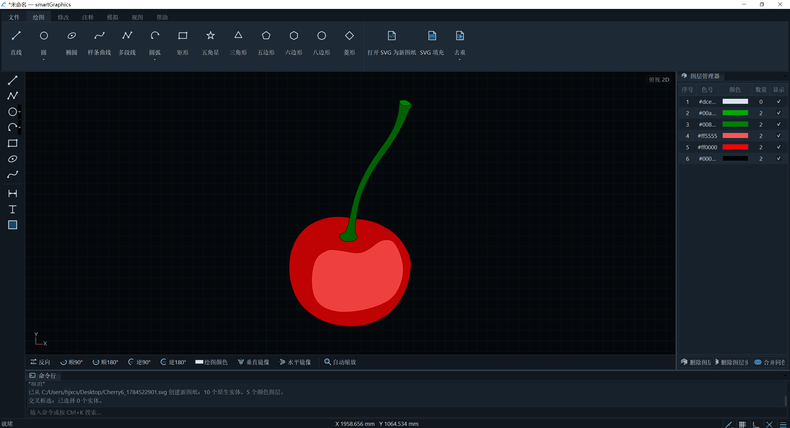

# vectorPath

vectorPath 是一个面向 Windows 的现代二维 CAD/CAM 学习与技术展示项目，使用
C++17、Qt 5.12.10、OpenGL 和 Visual Studio/MSBuild 开发。项目覆盖二维绘制与编辑、图层和标注、
DWG/DXF/SVG/位图导入导出、刀路排序与仿真，以及可撤销的文档事务。

> 当前版本：`0.2.0-alpha.1`。项目仍在持续开发，不宣称完整兼容 AutoCAD。



> 位图经颜色分区和轮廓提取后转换为可编辑矢量实体，并按颜色组织到图层中。

## 主要能力

- 直线、圆、圆弧、椭圆、样条、多段线和常用规则图形。
- 修剪、延伸、打断、连接、倒角、圆角、偏移、阵列、拉伸、夹点编辑等二维操作。
- 图层、颜色、线宽、文字、标注、填充与可撤销/重做事务。
- 原生 `.vectorpath` 文档并兼容旧 `.smartcam`、`.smartcad` 文件、ASCII DXF、基于 GNU LibreDWG
  适配器的 DWG 读写。
- SVG 色块导入、像素精确的位图矢量化、偏移线填充与图层去重。
- 刀路排序、方向调整和交互式仿真。
- 深色、浅色和高对比度主题，Ribbon、停靠面板、快捷键与命令行。

## 位图矢量化：精确结果与大图优化

vectorPath 的位图导入不是模糊拟合，也不依赖 K-means、Potrace 或曲线平滑。算法按
像素精确比较颜色，使用四邻域判定色块，将结果转换为闭合 SVG 轮廓。它特别适合颜色边界
明确的图标、像素图、标牌和规则色块素材。

核心流程为：

`水平同色游程 → 相邻行严格重叠连接 → 并查集合并色块 → 生成有向边 → 共线压缩 → 闭合轮廓 → SVG`

游程采用半开区间 `[begin_x, end_x)`；相邻行只有同色游程真正重叠时才连接，端点接触不会
把斜对角像素错误合并。性能优化集中在数据表示和可控并行：游程提取与相邻行连接可并行，
ID 分配、并查集、轮廓压缩和 SVG 输出保持串行。小于 1,048,576 像素时，自动模式使用
单线程以避免线程调度开销。稳定 ID、规范化和排序保证单线程与多线程可以生成完全相同的
SVG 字节。

### 历史优化测量

基准程序与软件位图导入直接调用同一个 `bitmapToVectorResult()` 核心实现。以下为历史测量：
固定种子 `20260727`，在 64 位 Release 下使用 12 个自动线程，每种算法执行 3 次并取中位数。
原固定图片、逐文件 HTML 和 manifest 已从仓库移除；当前生成器使用合成图案，输入分布已有
变化，不能仅凭相同种子完全复现旧结果，也不将这些数值作为当前版本的验收结果。

| 测试集 | 正确性 | 四邻域 flood fill | 游程单线程 | 游程多线程 | 相对 flood fill | 相对单线程 | 峰值工作集 |
| --- | ---: | ---: | ---: | ---: | ---: | ---: | ---: |
| 1000 份相对均衡样本 | 1000/1000 | 19,618.17 ms | 7,015.54 ms | 4,879.50 ms | **4.02×** | **1.44×** | 359.3 MB |
| 5000 份大图压力样本 | 5000/5000 | 1,216,018.72 ms | 279,075.69 ms | 102,223.19 ms | **11.90×** | **2.73×** | 384.1 MB |

5000 份测试的逐文件加速比 P10/P50/P90 为 **2.88× / 13.70× / 27.80×**。其中 4010 张
是 4096×4096 图片，因此这组结果重点证明大图压力和长时间连续处理下的优化效果与稳定性，
不能据此承诺所有图片都获得相同加速；小图、棋盘格和高度离散色块可能受固定开销影响。
当前基准也没有设置单独的计时外预热轮次。

- [生成样本与运行基准](sgraphVectorBenchmark/README.md)
- [测试方法与结果说明](sgraphDocs/TEST_RESULTS.md)

## 快速构建

使用 Visual Studio 2022 打开根目录的 `vectorPath.sln`，选择 `Debug/Release` 和
`Win32/x64`，将 `vectorPath` 设为启动项目即可编译运行。桌面构建需安装 C++ 桌面工具、
Qt 5.12.10 MSVC 套件和 Qt VS Tools。解决方案直接使用原生 `.vcxproj`，是唯一的构建入口，
不依赖 CMake、Ninja 或 Python；仓库不包含 Qt SDK。最后的 CMake 版本保留在 Git 提交
`12fb231`，第三方源码附带的 CMake 文件保持原样且不参与构建。

命令行构建（VS 开发者 PowerShell 或任意能调用 MSBuild 的终端）：

```powershell
msbuild vectorPath.sln /m /p:Configuration=Release /p:Platform=x64
msbuild vectorPath.sln /m /p:Configuration=Debug /p:Platform=Win32
```

生成结果落在 `build/msbuild/<位数>/<配置>`，构建后自动部署 Qt DLL、插件、翻译、
Qt ADS 与 LibreDWG 工具。测试、性能基准和纯核心不属于“生成解决方案”的默认范围，
按需单独构建：

```powershell
msbuild sgraphTests/vp_desktop_tests.vcxproj /m /p:Configuration=Release /p:Platform=x64
msbuild sgraphTests/vp_core_tests.vcxproj /m /p:Configuration=Release /p:Platform=x64
msbuild sgraphGeometry/vp_geometry_core.vcxproj /m /p:Configuration=Release /p:Platform=x64 /p:VpCoreOnly=true
```

测试程序按套件名运行：`vectorPathDesktopTests.exe --list-suites` 列出桌面 38 个套件，
`vectorPathDesktopTests.exe <套件名>` 运行其中一个；核心测试为 4 个套件。

Qt 不在常用路径时设置 `SGRAPH_QT64_DIR`、`SGRAPH_QT32_DIR` 或 `QTDIR`，也可用
`/p:VpQtDir=<路径>`，或在仓库根的 `vp_local.props` 中固定。完整说明见
[构建说明](sgraphDocs/BUILDING.md)及[架构说明](sgraphDocs/ARCHITECTURE.md)。

## 解决方案中的项目

`vectorPath.sln` 包含 16 个原生 `.vcxproj`，在“解决方案资源管理器”里按磁盘目录分组。
依赖方向自下而上：`Application → GUI → Render / IO / Commands → Document → Geometry →
GeometryCore → Core`，第三方组件只在需要它们的模块里被引用。默认“生成解决方案”构建
前 12 个项目，后 4 个需单独生成。

| 项目 | 目录 | 类型 | 直接依赖 | 说明 |
| --- | --- | --- | --- | --- |
| `vectorPath` | `sgraphApp` | 可执行文件 | 其余 11 个自研/第三方项目 | 应用入口：装配 Ribbon 主窗口、主题、翻译与设置迁移；构建后部署 Qt 运行库、Qt ADS 与 LibreDWG。 |
| `smartGui` | `sgraphGui` | 静态库 | smartRender、smartIo、SARibbonBar、qtadvanceddocking-qt5 | 主窗口、Ribbon、停靠面板、属性树、快捷键、对话框与主题管理。 |
| `smartRender` | `sgraphRender` | 静态库 | smartCommands | OpenGL 视口：绘制、缩放选择、对象捕捉、夹点与各类编辑预览。 |
| `smartCommands` | `sgraphCommands` | 静态库 | smartDocument | 命令目录、别名、补全，以及绝对/相对/极坐标输入解析。 |
| `smartIo` | `sgraphIo` | 静态库 | smartDocument、Clipper2 | DXF/DWG/SVG/位图编解码、矢量导入、位图矢量化与填充生成。 |
| `smartDocument` | `sgraphDocument` | 静态库 | smartGeometry | 文档模型：图元与图层、文字/标注/打印样式、事务与撤销重做、恢复与原生持久化。 |
| `smartGeometry` | `sgraphGeometry` | 静态库（含 Qt） | smartGeometryCore | 仍依赖 Qt 的几何实现：文字、标注、填充、刀路，以及 Qt 点/文本适配。 |
| `smartGeometryCore` | `sgraphGeometry` | 静态库（无 Qt） | smartCore、Clipper2 | 纯几何核心：六种曲线实体、标准图形、样条/椭圆、布尔运算、多边形测量与绘图辅助状态。 |
| `smartCore` | `sgraphCore` | 接口库（仅头文件） | — | `VpResult<T>` 与 ID 集合工具；纯 C++，不产生二进制，其他模块按需包含。 |
| `Clipper2` | `sgraphThirdParty` | 静态库（无 Qt） | — | 原样引入的多边形布尔库，只在几何核心与 IO 内部使用。 |
| `SARibbonBar` | `sgraphThirdParty` | 静态库 | — | 原样引入的 Ribbon 控件库（SARibbon 2.9.0）。 |
| `qtadvanceddocking-qt5` | `sgraphThirdParty` | 动态库 | — | 原样引入的 Qt 停靠窗口组件（Qt ADS 4.4.1），输出 `qtadvanceddocking-qt5.dll`。 |
| `vectorPathDesktopTests` | `sgraphTests` | 可执行文件（默认不生成） | 与 `vectorPath` 相同 | 34 个桌面套件；`--list-suites` 列出名称，按套件名运行单个套件。 |
| `vectorPathCoreTests` | `sgraphTests` | 可执行文件（默认不生成） | smartGeometryCore、smartCore、Clipper2 | 4 个无 Qt 套件，可在 `/p:VpCoreOnly=true` 下单独构建。 |
| `vectorPathIdCollectionBenchmark` | `sgraphTests` | 可执行文件（默认不生成） | smartCore | ID 集合增删查性能基准，不依赖 Qt。 |
| `smartBitmapVectorBenchmark` | `sgraphVectorBenchmark` | 可执行文件（默认不生成） | smartIo、smartDocument、smartGeometry | 位图矢量化正确性与性能基准，支持 `--cases`、`--seed`、`--smoke` 等参数。 |

## 文档

- [运行性能与内存优化计划](sgraphDocs/vp_performance_memory_plan.md)
- [完整代码架构与文件参考](sgraphDocs/CODEBASE_REFERENCE.md)
- [位图矢量化详尽源码与调用关系](sgraphDocs/BITMAP_VECTORIZATION_SOURCE_REFERENCE.md)
- [使用说明](sgraphDocs/USER_GUIDE.md)
- [简版架构说明](sgraphDocs/ARCHITECTURE.md)
- [完整编译工具链](sgraphDocs/BUILDING.md)
- [测试结果](sgraphDocs/TEST_RESULTS.md)
- [实现状态](sgraphDocs/vp_implementation_status.md)
- [默认快捷键](sgraphDocs/vp_default_shortcuts.md)
- [第三方组件与许可证](THIRD_PARTY_NOTICES.md)

## 仓库结构

所有自研模块目录使用 `sgraph` 前缀；第三方源码与工具统一放在
`sgraphThirdParty`。`build`、`dist`、基准样本、全部本地基准结果和本地 Qt SDK 均不会提交。
仓库保留基准运行入口、样本生成器和验证代码，图片、manifest 与 HTML 在运行时本地生成。

## 许可与状态

vectorPath 自研代码目前采用仓库内的
[`LICENSE.md`](LICENSE.md)；第三方组件继续适用各自许可证。
特别是 LibreDWG 为 GPLv3+，Qt 5.12.10 和 Qt Advanced Docking System 适用 LGPL
条款。发布二进制前请阅读 [`THIRD_PARTY_NOTICES.md`](THIRD_PARTY_NOTICES.md)。

欢迎通过 Issue 提交可复现的问题；安全问题请按 [`SECURITY.md`](SECURITY.md) 处理。
