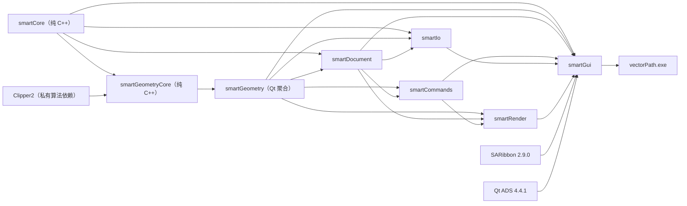

# vectorPath 代码库参考

## 1. 概览

vectorPath 是 Windows 二维 CAD/CAM 学习与技术展示项目，覆盖二维实体、交互式绘图与修改、图层与样式、文档事务、撤销重做、恢复审计、多格式 IO、精确颜色位图矢量化、刀路排序与仿真，以及 Windows 多架构构建与部署。

- 技术栈：C++17、Qt 5.12.10、Visual Studio/MSBuild 与 Qt/MSBuild；实体由 QPainter 在 QOpenGLWidget 上绘制。运行版本 `0.2.0-alpha.1`，许可证为 source-available，不等同 OSI 开源。
- 构建：根解决方案 `vectorPath.sln` 覆盖 Win32/x64 的 Debug/Release；桌面输出在 `build/msbuild/<位数>/<配置>`，纯核心在 `build/msbuild/core/<位数>/<配置>`；`/p:VpCoreOnly=true` 只构建 Core、GeometryCore 与 Clipper2，不查找 Qt。
- 范围：`ACAD.3D.MODEL`、`ACAD.3D.EDIT`、`ACAD.3D.VISUALIZE` 保持 `out_of_scope`；当前只有模型空间，没有图纸空间或布局视口，输出侧仅保留 CTB/STB 样式管理，页面设置、打印与 PDF 发布未实现。
- 渲染与数据库边界：不是完整 AutoCAD 数据库或完整 DWG 兼容实现；没有 GPU/VBO 批渲染管线，OpenGL 只提供上下文与 FBO，实体仍逐类经 QPainter 绘制。
- 并发与 IO 边界：`VpCadDocument` 非线程安全，只在 GUI 线程修改；位图算法内部并行不等于界面异步；DWG 依赖同步 LibreDWG 子进程转换，默认最长等待 120 秒；DXF 导入尚不是完整原子操作；撤销历史没有内存预算，保存点只有 `modified` 布尔值。

## 2. 依赖层次

箭头由被依赖目标指向使用者；工程与 target 名保留 `smart*` 历史命名，目录与源码使用 `sgraph`/`vp_` 前缀。

- 基础层不依赖 GUI；Geometry 不持有文档；Document 不依赖视口；IO 通过文档公开接口或中间值结构工作。
- `smartGeometryCore` 只编译一份纯算法，桌面 `smartGeometry` 通过工程引用复用；Qt 点/文本适配编入桌面聚合，纯核心不包含 Qt 适配头。
- `VpCadViewport` 与 `VpCadMainWindow` 在运行时仍承担较多命令编排，属于已知职责集中点，不得用新增反向编译依赖继续扩大。

## 3. 模块职责

每个模块一张表；`vp_*.vcxproj` 为原生工程入口，依赖列只列模块的直接编译依赖。

### sgraphApp

| 目录 | 代表文件 | 职责 | 依赖 |
| --- | --- | --- | --- |
| `sgraphApp/` | `vp_main.cpp` | 进程入口：High DPI 与共享 OpenGL 属性、QApplication、资源初始化、设置迁移、翻译、深色主题、最大化主窗口 | `smartGui`、Qt Core/Gui/Widgets |
|  | `vp_chinese_ui_translator.h/.cpp` | `VpChineseUiTranslator`：为未走 `.qm` 的固定 UI 文本提供中文映射，无匹配返回空串 |  |
|  | `vp_app.vcxproj` | `vectorPath` target，构建后复制翻译、Qt ADS、LibreDWG 并调用 windeployqt |  |

### sgraphCore

| 目录 | 代表文件 | 职责 | 依赖 |
| --- | --- | --- | --- |
| `sgraphCore/` | `vp_result.h` | `VpResult<T>` 与 `VpResult<void>`：成功值或 UTF-16 错误文本，可附未解码的原生错误字节 | 无内部依赖 |
|  | `vp_id_collection.h` | 按 ID 筛选与稳定删除记录，避免复制完整实体负载 |  |
|  | `vp_core.vcxproj` | `smartCore`，纯头文件 Utility，使用 C++17 标准库，不链接 Qt |  |

### sgraphGeometry

| 目录 | 代表文件 | 职责 | 依赖 |
| --- | --- | --- | --- |
| `sgraphGeometry/` | `vp_geometry_types.h`、`vp_curve_entities.h` | `VpPoint2d`、`distance()` 与六种纯曲线实体（Line/Circle/Arc/Polyline/Spline/Ellipse）的唯一定义 | `smartCore`、Clipper2、Qt（仅桌面聚合） |
|  | `vp_entity.h` | 实体枚举、含 QString/QColor 的其余实体、`VpEntityRecord`、关联阵列与稳定 ID |  |
|  | `vp_polygon_boolean`、`vp_spline_geometry`、`vp_ellipse_geometry`、`vp_standard_shape`、`vp_toolpath` | Clipper2 布尔运算、样条与椭圆求值、标准形状顶点、刀路排序 |  |
|  | `vp_geometry_core.vcxproj` / `vp_geometry.vcxproj` | `smartGeometryCore`（无 Qt、始终构建）与 `smartGeometry`（桌面聚合，含标注、填充检查、Qt 适配） |  |

### sgraphDocument

| 目录 | 代表文件 | 职责 | 依赖 |
| --- | --- | --- | --- |
| `sgraphDocument/` | `vp_cad_document.h` 及 `vp_cad_document*.cpp` | `VpCadDocument` 唯一权威状态：实体、图层、图层状态、文字/尺寸样式、绘图设置、文件路径与撤销/重做栈；实现按 base、history、io、audit、color_layer、layer_state、text_style、dimension_style 分拆 | `smartCore`、`smartGeometry`、Qt Core/Gui |
|  | `vp_document_transaction.h/.cpp` | `VpDocumentTransaction`：暂存变更，显式 `commit()` 才生成一个历史项 |  |
|  | `vp_entity_binary_io`、`vp_dimension_binary_io`、`vp_hatch_binary_io`、`vp_associative_array_io`、`vp_document_style_io` | 实体、尺寸、Hatch、关联阵列与样式表的二进制读写及格式版本分支 |  |
|  | `vp_document_recovery_manager`、`vp_document_audit`、`vp_plot_style_table`、`vp_toolpath_document` | 恢复副本 `.vectorpath.sv$`、文档审计、CTB/STB 打印样式、刀路排序的事务提交 |  |

### sgraphCommands

| 目录 | 代表文件 | 职责 | 依赖 |
| --- | --- | --- | --- |
| `sgraphCommands/` | `vp_command_catalog.h/.cpp` | 命令与别名集合，为命令行 QCompleter 提供全部补全项与前缀匹配 | `smartGeometry`、`smartDocument`、Qt Core |
|  | `vp_coordinate_input.h/.cpp` | `VpCoordinateInputMode`、`VpCoordinateInput` 与 `parseCoordinateInput()`，解析绝对/相对/极坐标文本 |  |
|  | `vp_commands.vcxproj` | `smartCommands`；实际命令分发在 `VpCadMainWindow::executeCommand()`，交互由视口状态机执行 |  |

### sgraphIo

| 目录 | 代表文件 | 职责 | 依赖 |
| --- | --- | --- | --- |
| `sgraphIo/` | `vp_i_file_codec.h`、`vp_file_compatibility_report.h` | `VpIFileCodec` 与 `VpFileCompatibilityReport`：统一格式契约、读写统计、警告与降级 | `smartCore`、`smartGeometry`、`smartDocument`、Qt Concurrent |
|  | `vp_dxf_codec`、`vp_dxf_pair`、`vp_dxf_entity_io`、`vp_dxf_hatch_io`、`vp_dxf_table_io` | ASCII DXF 的 pair、表、实体与 Hatch 读写子集 |  |
|  | `vp_dwg_codec`、`vp_dwg_dxf_adapter` | LibreDWG 子进程完成 DWG↔R2000 DXF 转换、工具可用性探测与兼容报告 |  |
|  | `vp_svg_parser`、`vp_svg_path_parser`、`vp_svg_vector_data`、`vp_vector_fill`、`vp_vector_document_import` | SVG 与位图中间模型、填充规则、颜色图层与导入事务 |  |
|  | `vp_bitmap_vectorizer.h`、`vp_bitmap_run_vectorizer.cpp`、`vp_bitmap_contour_stitcher.cpp` | 位图矢量化公共类型、游程与并查集核心、边压缩与闭环 |  |

### sgraphRender

| 目录 | 代表文件 | 职责 | 依赖 |
| --- | --- | --- | --- |
| `sgraphRender/` | `vp_cad_viewport.h`、`vp_cad_viewport.cpp` | `VpCadViewport`：公开接口、信号、事件覆写与状态定义，基础绑定与工具切换 | `smartCommands`、`smartDocument`、`smartGeometry`、Qt OpenGL/Widgets |
|  | 数十个 `vp_cad_viewport_*.cpp` | 按实现职责拆分事件、渲染、选择、捕捉、夹点、变换、阵列、曲线编辑与预览，共用同一类状态 |  |
|  | `vp_object_snap`、`vp_curve_offset`、`vp_associative_array_geometry`、`vp_polyline_*`、`vp_spline_edit`、`vp_circle_tangent_math`、`vp_arc_construction_geometry` | 捕捉、偏移、阵列、多段线与相切/圆弧构造等纯算法 |  |
|  | `vp_render.vcxproj` | `smartRender`，登记全部视口分拆源文件 |  |

### sgraphGui

| 目录 | 代表文件 | 职责 | 依赖 |
| --- | --- | --- | --- |
| `sgraphGui/` | `vp_cad_main_window.h/.cpp` 及 `vp_cad_main_window_*.cpp` | `VpCadMainWindow`（`SARibbonMainWindow`）：Action/Ribbon/ADS 停靠/状态栏、命令路由、文件流程、导入、审计与恢复、样式、快捷键、UI 比例 | 全部自研库、SARibbon、Qt ADS、Qt Widgets/Svg/PrintSupport |
|  | `vp_cad_workspace_widget`、`vp_command_line_widget`、`vp_selection_context_bar`、`vp_cad_property_tree`/`vp_cad_property_ui`、`vp_dialog_service` | 工作区与视口容器、命令行、选择上下文栏、属性面板、统一对话框策略 |  |
|  | `vp_shortcut_manager`/`vp_shortcut_dialog`、`vp_vector_import_dialog`、`vp_toolpath_sort_dialog`、`vp_toolpath_simulation_controller`、`vp_quick_entity_operation` | 快捷键绑定与冲突检查、导入对话框、刀路排序与仿真、快捷实体操作 |  |
|  | `sgraphDesignSystem/vp_design_token.h`、`vp_theme_manager.h/.cpp`、三套主题 JSON、`vp_icon_provider`、`vp_proxy_style` | 设计 token、主题加载与应用、主题自适应语义图标、Qt 代理样式 |  |
|  | `vp_application_settings_migration.h/.cpp` | `migrateMissingApplicationSettings()`：只复制新位置缺失的键，读取或写入失败返回 -1 |  |

### sgraphTests

| 目录 | 代表文件 | 职责 | 依赖 |
| --- | --- | --- | --- |
| `sgraphTests/` | `vp_core_tests.vcxproj`、`vp_core_test_main.cpp` | `vectorPathCoreTests`：4 个纯核心套件，不创建 Qt 应用、不加载 Qt DLL | `smartCore`、`smartGeometryCore`、`smartDocument` 等被测目标 |
|  | `vp_desktop_tests.vcxproj`、`vp_desktop_test_main.cpp`、`vp_test_runner.h` | `vectorPathDesktopTests`：34 个 Qt 套件，含位图 smoke 共 40 项检查 |  |
|  | 38 个 `*_test.cpp` 及可选 `vp_id_collection_benchmark.vcxproj` | 覆盖结果类型、几何、文档、IO、视口、曲线、标注、图层、GUI 与刀路；`--list-suites` 列套件，控件测试需 `QT_QPA_PLATFORM=offscreen` |  |

### sgraphVectorBenchmark

| 目录 | 代表文件 | 职责 | 依赖 |
| --- | --- | --- | --- |
| `sgraphVectorBenchmark/` | `vp_bitmap_benchmark.vcxproj` | 可选 `smartBitmapVectorBenchmark`，不参与解决方案默认生成 | `smartIo`、`smartDocument`、`smartGeometry` |
|  | `src/vp_bitmap_benchmark_types.h`、`generator`、`validation`、`report` | case/算法摘要/结果/选项模型、固定种子合成图、轮廓哈希与回栅格验证、manifest 与 HTML 报告 |  |
|  | `src/vp_bitmap_flood_baseline.cpp` | 逐像素 flood fill 基线，仅用于正确性与性能参照 |  |
|  | `src/vp_bitmap_vector_benchmark.cpp` | 参数解析、三算法重复计时取中位数、诊断输出；结果目录按日期序号命名并被 Git 忽略 |  |

### sgraphBuildTools

| 目录 | 代表文件 | 职责 | 依赖 |
| --- | --- | --- | --- |
| `sgraphBuildTools/` | `vp_defaults.props`、`vp_common.props`、`vp_build.targets` | 共用路径、Qt 查找、编译属性与 `VpDeployRuntime` 部署目标；本机路径写入已忽略的 `vp_local.props` | 全部 MSBuild 工程 |

### sgraphThirdParty

| 目录 | 代表文件 | 职责 | 依赖 |
| --- | --- | --- | --- |
| `sgraphThirdParty/` | `Clipper2`、`libredwg-0.14-win64`、`Qt-Advanced-Docking-System-4.4.1`、`SARibbon-2.9.0` 及 `vp_clipper2`/`vp_qtads`/`vp_saribbon` 工程 | 第三方源码与原生工程，保持上游内容，不按自研风格修改；来源见 `s_dependencies.md` | 被 Geometry/Gui 引用 |

### sgraphDocs

| 目录 | 代表文件 | 职责 | 依赖 |
| --- | --- | --- | --- |
| `sgraphDocs/` | `ARCHITECTURE.md`、`BUILDING.md`、`FEATURES.md`、`USER_GUIDE.md` 等 | 架构、构建、功能、测试、性能与编码规范文档 | 无代码依赖 |
|  | `vp_autocad_2026_feature_catalog.yaml`、`vp_autocad_gap_matrix.yaml`、`vp_smartcad_feature_inventory.yaml` | 功能基线、差距状态与实现证据；功能评审前先读前两份 |  |

## 4. 关键类型与约定

| 类型 | 位置 | 契约与不变量 |
| --- | --- | --- |
| `VpResult<T>` / `VpResult<void>` | `sgraphCore/vp_result.h` | 公共 API 统一返回类型：`success()`/`failure()`/`failureWithNativeDetail()`；失败携带 UTF-16 错误文本，成功才应读取 `value()`；`failure()` 要求 `TValue{}` 可默认构造，失败访问 `value()` 无保护 |
| `VpEntityRecord` | `sgraphGeometry/vp_entity.h` | 文档实体聚合：稳定 `VpEntityId`、`VpEntityType`、`VpEntityGeometry` 变体、图层与显示属性、可选关联阵列；`type` 必须与变体匹配，ID 在活动文档内唯一 |
| `VpCadDocument` | `sgraphDocument/vp_cad_document.h` | 业务状态唯一权威：实体、图层、样式、绘图设置、路径与历史栈；QObject 信号驱动 UI，但非线程安全，视图不得持有第二份可提交真相 |
| `VpDocumentTransaction` | `sgraphDocument/vp_document_transaction.h` | `beginTransaction(label)` 返回独占事务；`add*`/`replaceEntity`/`removeEntity` 暂存变更，只有显式 `commit()` 生成单个历史项，析构不提交 |
| `VpIFileCodec` | `sgraphIo/vp_i_file_codec.h` | `id()`/`displayName()`/`extensions()` 与 `read()`/`write()`；读写返回 `VpResult<VpFileCompatibilityReport>`，成功报告仍可能带警告，调用方必须展示或记录 |
| `VpCadViewport` | `sgraphRender/vp_cad_viewport.h` | QOpenGLWidget 视口：世界/屏幕变换、绘制、捕捉、选择、夹点、命令状态与动态预览；用 `QPointer<VpCadDocument>` 观察文档，结果经信号交给 GUI |
| `VpThemeManager` / `VpDesignToken` | `sgraphGui/sgraphDesignSystem/` | 主题与设计 token 的权威来源：加载主题 JSON、应用样式表、保存模式并发信号；图标按语义枚举与 token 生成 |
| `VpCommandCatalog` / `VpCoordinateInput` | `sgraphCommands/` | 命令与别名的补全数据、坐标语法解析；分发与交互分别由主窗口和视口承担 |
| `VpToolMode` / `VpGripHandle` / `VpObjectSnapResult` | `sgraphRender/` | 交互分派键与夹点、捕捉结果值结构，不是持久化实体类型 |

### 运行约定

- 事务与预览：动态预览只用临时值，不写文档；最终确认才创建并提交事务；一个用户动作尽量对应一个事务；取消时清理输入点、参考实体、捕捉、预览与夹点。
- 线程与进程：QWidget、窗口、视口与 `VpCadDocument` 只在 GUI 线程；位图逐行提取在局部 `QThreadPool` 分片写，汇合后串行编号归并；LibreDWG 通过 `QProcess` 子进程，启动上限 10 秒，默认完成上限 120 秒，超时后 kill 并等待 5 秒。
- 异步化模式：GUI 线程生成不可变快照 → 后台纯计算或子进程 → 携带任务代次返回 → GUI 线程检查文档与取消状态 → 单事务提交；禁止后台线程持有并修改文档裸指针。
- 扩展规则：新增实体类型或绘图命令时，必须同时补齐 Geometry 变体、文档事务与版本分支、渲染/命中/夹点、IO、属性 UI、命令与别名、动态预览、图标与自动测试；只加枚举值或补全字符串不构成可用功能。

## 5. 文件命名与行数规则

- 目录：自研目录统一 `sgraph` 前缀，设计系统位于 `sgraphGui/sgraphDesignSystem/`。
- 文件：`vp_` 加小写下划线；新增拆分实现文件同样使用 `vp_` 前缀。
- 语言与风格：C++17、Qt 5.12.10，遵循 `sgraphDocs/vp_coding_style.md`。
- 命名：命名空间 `Vp`；类型 `Vp` 前缀，接口 `VpI` 前缀；局部变量与参数小写下划线；私有成员 `m_` 加小写下划线。
- 大括号：控制语句、函数、类型与命名空间的左大括号必须另起一行，禁止行尾左大括号。
- 行数：每个自研 `.h`/`.cpp` 最多 800 个物理行（空行与注释计入），约 700 行即应按单一职责拆分；禁止用压缩排版、同行多语句或删除必要注释规避限制。
- 工程：新增源码必须加入所属模块的 `vp_*.vcxproj` 并保持 `.vcxproj.filters` 逻辑分组；拆分不得改变公共接口或运行行为。
- 历史标识：`smartCad`、`smartCam`、`SMARTCAD_*` 等名称仍承担文件、设置、资源、布局与构建兼容责任，不能仅凭品牌变化删除。

## 6. 原生格式版本

- 入口：`sgraphDocument/vp_cad_document_io.cpp`；保存使用 `QSaveFile`，只有 stream 状态正常且 `commit()` 成功才替换目标文件。
- magic：8 字节 `SMCAD001`；当前格式版本 `24`，加载接受版本 1–24 并按 `formatVersion` 分支处理字段演进（实体字段自版本 2 起）。
- 编码：Little Endian，`QDataStream::Qt_5_12`；manifest 为紧凑 JSON，长度上限 1 MiB。
- manifest：`application` 仍写 `smartCad`（兼容字段），并记录 `formatVersion`、插入单位、角度格式与线/角精度。
- 扩展名：新文件默认 `.vectorpath`，兼容打开与保存 `.smartcam`、`.smartcad`。
- 恢复副本：`.vectorpath.sv$`，写入时不改变文档路径与 `modified` 状态。
- 兼容别名：设置来源 `smartCamLearning/smartCam` 与 `smartCadLearning/smartGraphics`（只迁移缺失键，不覆盖新值）；打印样式别名 `smartCad.stb`/`smartCam.stb`；qrc 前缀 `/smartcad/themes`；Dock object name 与 workspace version 用于布局恢复。
- 变更门槛：修改字段顺序、枚举数值、magic 或 manifest 时必须提升版本，并保留旧文件回归测试与迁移路径。

## 7. 相关文档

- [README](../README.md) · [架构概览](ARCHITECTURE.md) · [构建指南](BUILDING.md)
- [使用说明与快捷键](USER_GUIDE.md) · [编码规范](vp_coding_style.md)
- [功能与路线](FEATURES.md) · [测试与验证](TESTING.md) · [性能与内存](PERFORMANCE.md)
- [位图矢量化算法](BITMAP_VECTORIZATION.md) · [AutoCAD 基线资料](AUTOCAD_BASELINE.md)
- 数据文件：[功能目录](vp_autocad_2026_feature_catalog.yaml)、[差距矩阵](vp_autocad_gap_matrix.yaml)、[实现证据清单](vp_smartcad_feature_inventory.yaml)
- [位图基准说明](../sgraphVectorBenchmark/README.md) · [协作约束](../AGENTS.md)
