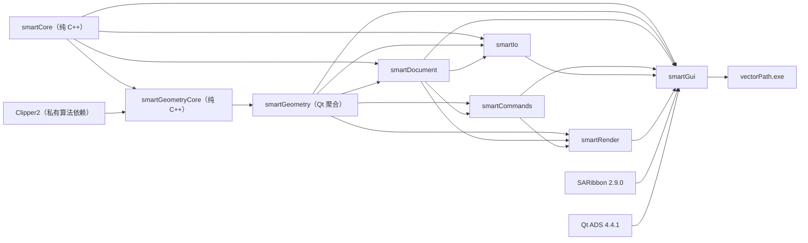
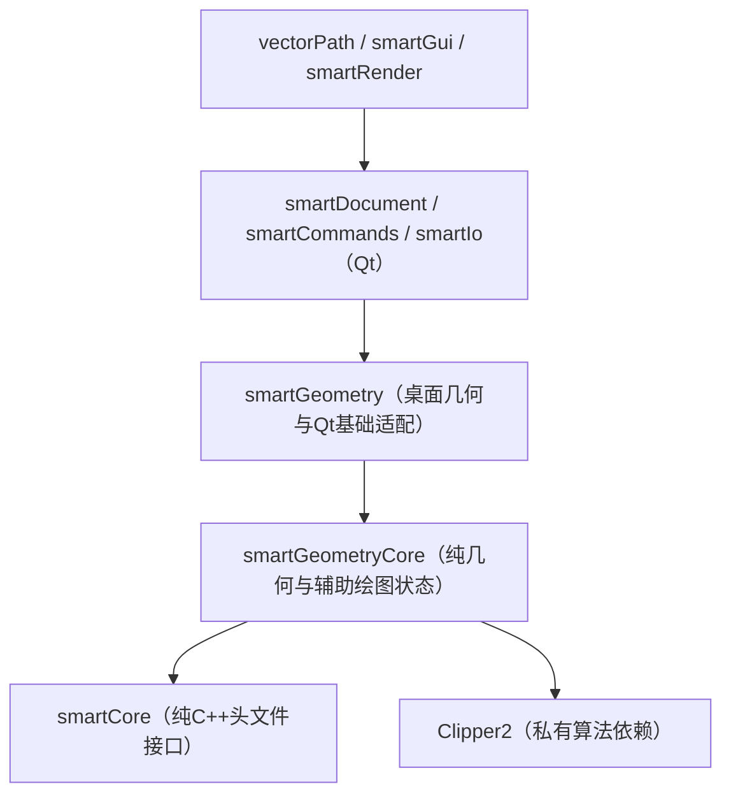

# vectorPath 项目文档

> 本文档由原 `ARCHITECTURE.md`、`AUTOCAD_BASELINE.md`、`BITMAP_VECTORIZATION.md`、
> `BUILDING.md`、`CODEBASE_REFERENCE.md`、`FEATURES.md`、`PERFORMANCE.md`、
> `TESTING.md`、`USER_GUIDE.md` 九个文档合并而成。功能数据文件
> `vp_autocad_2026_feature_catalog.yaml`、`vp_autocad_gap_matrix.yaml`、
> `vp_smartcad_feature_inventory.yaml` 与编码规范 [vp_coding_style.md](vp_coding_style.md)
> 保持独立。

## 目录

- [概览与代码库参考](#codebase)
- [代码架构](#architecture)
- [功能与路线](#features)
- [使用说明与快捷键](#user-guide)
- [构建](#building)
- [测试与验证](#testing)
- [性能与内存](#performance)
- [位图矢量化](#bitmap)
- [AutoCAD 基线资料](#autocad)

---

## <a id="codebase"></a> 概览与代码库参考

### 1. 概览

vectorPath 是 Windows 二维 CAD/CAM 学习与技术展示项目，覆盖二维实体、交互式绘图与修改、图层与样式、文档事务、撤销重做、恢复审计、多格式 IO、精确颜色位图矢量化、刀路排序与仿真，以及 Windows 多架构构建与部署。

- 技术栈：C++17、Qt 5.12.10、Visual Studio/MSBuild 与 Qt/MSBuild；实体由 QPainter 在 QOpenGLWidget 上绘制。运行版本 `0.2.0-alpha.1`，许可证为 source-available，不等同 OSI 开源。
- 构建：根解决方案 `vectorPath.sln` 覆盖 Win32/x64 的 Debug/Release；桌面输出在 `build/msbuild/<位数>/<配置>`，纯核心在 `build/msbuild/core/<位数>/<配置>`；`/p:VpCoreOnly=true` 只构建 Core、GeometryCore 与 Clipper2，不查找 Qt。
- 范围：`ACAD.3D.MODEL`、`ACAD.3D.EDIT`、`ACAD.3D.VISUALIZE` 保持 `out_of_scope`；当前只有模型空间，没有图纸空间或布局视口，输出侧仅保留 CTB/STB 样式管理，页面设置、打印与 PDF 发布未实现。
- 渲染与数据库边界：不是完整 AutoCAD 数据库或完整 DWG 兼容实现；没有 GPU/VBO 批渲染管线，OpenGL 只提供上下文与 FBO，实体仍逐类经 QPainter 绘制。
- 并发与 IO 边界：`VpCadDocument` 非线程安全，只在 GUI 线程修改；位图算法内部并行不等于界面异步；DWG 依赖同步 LibreDWG 子进程转换，默认最长等待 120 秒；DXF 导入尚不是完整原子操作；撤销历史没有内存预算，保存点只有 `modified` 布尔值。

### 2. 依赖层次

箭头由被依赖目标指向使用者；工程与 target 名保留 `smart*` 历史命名，目录与源码使用 `sgraph`/`vp_` 前缀。



- 基础层不依赖 GUI；Geometry 不持有文档；Document 不依赖视口；IO 通过文档公开接口或中间值结构工作。
- `smartGeometryCore` 只编译一份纯算法，桌面 `smartGeometry` 通过工程引用复用；Qt 点/文本适配编入桌面聚合，纯核心不包含 Qt 适配头。
- `VpCadViewport` 与 `VpCadMainWindow` 在运行时仍承担较多命令编排，属于已知职责集中点，不得用新增反向编译依赖继续扩大。

### 3. 模块职责

每个模块一张表；`vp_*.vcxproj` 为原生工程入口，依赖列只列模块的直接编译依赖。

#### sgraphApp

| 目录 | 代表文件 | 职责 | 依赖 |
| --- | --- | --- | --- |
| `sgraphApp/` | `vp_main.cpp` | 进程入口：High DPI 与共享 OpenGL 属性、QApplication、资源初始化、设置迁移、翻译、深色主题、最大化主窗口 | `smartGui`、Qt Core/Gui/Widgets |
|  | `vp_chinese_ui_translator.h/.cpp` | `VpChineseUiTranslator`：为未走 `.qm` 的固定 UI 文本提供中文映射，无匹配返回空串 |  |
|  | `vp_app.vcxproj` | `vectorPath` target，构建后复制翻译、Qt ADS、LibreDWG 并调用 windeployqt |  |

#### sgraphCore

| 目录 | 代表文件 | 职责 | 依赖 |
| --- | --- | --- | --- |
| `sgraphCore/` | `vp_result.h` | `VpResult<T>` 与 `VpResult<void>`：成功值或 UTF-16 错误文本，可附未解码的原生错误字节 | 无内部依赖 |
|  | `vp_id_collection.h` | 按 ID 筛选与稳定删除记录，避免复制完整实体负载 |  |
|  | `vp_core.vcxproj` | `smartCore`，纯头文件 Utility，使用 C++17 标准库，不链接 Qt |  |

#### sgraphGeometry

| 目录 | 代表文件 | 职责 | 依赖 |
| --- | --- | --- | --- |
| `sgraphGeometry/` | `vp_geometry_types.h`、`vp_curve_entities.h` | `VpPoint2d`、`distance()` 与六种纯曲线实体（Line/Circle/Arc/Polyline/Spline/Ellipse）的唯一定义 | `smartCore`、Clipper2、Qt（仅桌面聚合） |
|  | `vp_entity.h` | 实体枚举、含 QString/QColor 的其余实体、`VpEntityRecord`、关联阵列与稳定 ID |  |
|  | `vp_polygon_boolean`、`vp_spline_geometry`、`vp_ellipse_geometry`、`vp_standard_shape`、`vp_toolpath` | Clipper2 布尔运算、样条与椭圆求值、标准形状顶点、刀路排序 |  |
|  | `vp_geometry_core.vcxproj` / `vp_geometry.vcxproj` | `smartGeometryCore`（无 Qt、始终构建）与 `smartGeometry`（桌面聚合，含标注、填充检查、Qt 适配） |  |

#### sgraphDocument

| 目录 | 代表文件 | 职责 | 依赖 |
| --- | --- | --- | --- |
| `sgraphDocument/` | `vp_cad_document.h` 及 `vp_cad_document*.cpp` | `VpCadDocument` 唯一权威状态：实体、图层、图层状态、文字/尺寸样式、绘图设置、文件路径与撤销/重做栈；实现按 base、history、io、audit、color_layer、layer_state、text_style、dimension_style 分拆 | `smartCore`、`smartGeometry`、Qt Core/Gui |
|  | `vp_document_transaction.h/.cpp` | `VpDocumentTransaction`：暂存变更，显式 `commit()` 才生成一个历史项 |  |
|  | `vp_entity_binary_io`、`vp_dimension_binary_io`、`vp_hatch_binary_io`、`vp_associative_array_io`、`vp_document_style_io` | 实体、尺寸、Hatch、关联阵列与样式表的二进制读写及格式版本分支 |  |
|  | `vp_document_recovery_manager`、`vp_document_audit`、`vp_plot_style_table`、`vp_toolpath_document` | 恢复副本 `.vectorpath.sv$`、文档审计、CTB/STB 打印样式、刀路排序的事务提交 |  |

#### sgraphCommands

| 目录 | 代表文件 | 职责 | 依赖 |
| --- | --- | --- | --- |
| `sgraphCommands/` | `vp_command_catalog.h/.cpp` | 命令与别名集合，为命令行 QCompleter 提供全部补全项与前缀匹配 | `smartGeometry`、`smartDocument`、Qt Core |
|  | `vp_coordinate_input.h/.cpp` | `VpCoordinateInputMode`、`VpCoordinateInput` 与 `parseCoordinateInput()`，解析绝对/相对/极坐标文本 |  |
|  | `vp_commands.vcxproj` | `smartCommands`；实际命令分发在 `VpCadMainWindow::executeCommand()`，交互由视口状态机执行 |  |

#### sgraphIo

| 目录 | 代表文件 | 职责 | 依赖 |
| --- | --- | --- | --- |
| `sgraphIo/` | `vp_i_file_codec.h`、`vp_file_compatibility_report.h` | `VpIFileCodec` 与 `VpFileCompatibilityReport`：统一格式契约、读写统计、警告与降级 | `smartCore`、`smartGeometry`、`smartDocument`、Qt Concurrent |
|  | `vp_dxf_codec`、`vp_dxf_pair`、`vp_dxf_entity_io`、`vp_dxf_hatch_io`、`vp_dxf_table_io` | ASCII DXF 的 pair、表、实体与 Hatch 读写子集 |  |
|  | `vp_dwg_codec`、`vp_dwg_dxf_adapter` | LibreDWG 子进程完成 DWG↔R2000 DXF 转换、工具可用性探测与兼容报告 |  |
|  | `vp_svg_parser`、`vp_svg_path_parser`、`vp_svg_vector_data`、`vp_vector_fill`、`vp_vector_document_import` | SVG 与位图中间模型、填充规则、颜色图层与导入事务 |  |
|  | `vp_bitmap_vectorizer.h`、`vp_bitmap_run_vectorizer.cpp`、`vp_bitmap_contour_stitcher.cpp` | 位图矢量化公共类型、游程与并查集核心、边压缩与闭环 |  |

#### sgraphRender

| 目录 | 代表文件 | 职责 | 依赖 |
| --- | --- | --- | --- |
| `sgraphRender/` | `vp_cad_viewport.h`、`vp_cad_viewport.cpp` | `VpCadViewport`：公开接口、信号、事件覆写与状态定义，基础绑定与工具切换 | `smartCommands`、`smartDocument`、`smartGeometry`、Qt OpenGL/Widgets |
|  | 数十个 `vp_cad_viewport_*.cpp` | 按实现职责拆分事件、渲染、选择、捕捉、夹点、变换、阵列、曲线编辑与预览，共用同一类状态 |  |
|  | `vp_object_snap`、`vp_curve_offset`、`vp_associative_array_geometry`、`vp_polyline_*`、`vp_spline_edit`、`vp_circle_tangent_math`、`vp_arc_construction_geometry` | 捕捉、偏移、阵列、多段线与相切/圆弧构造等纯算法 |  |
|  | `vp_render.vcxproj` | `smartRender`，登记全部视口分拆源文件 |  |

#### sgraphGui

| 目录 | 代表文件 | 职责 | 依赖 |
| --- | --- | --- | --- |
| `sgraphGui/` | `vp_cad_main_window.h/.cpp` 及 `vp_cad_main_window_*.cpp` | `VpCadMainWindow`（`SARibbonMainWindow`）：Action/Ribbon/ADS 停靠/状态栏、命令路由、文件流程、导入、审计与恢复、样式、快捷键、UI 比例 | 全部自研库、SARibbon、Qt ADS、Qt Widgets/Svg/PrintSupport |
|  | `vp_cad_workspace_widget`、`vp_command_line_widget`、`vp_selection_context_bar`、`vp_cad_property_tree`/`vp_cad_property_ui`、`vp_dialog_service` | 工作区与视口容器、命令行、选择上下文栏、属性面板、统一对话框策略 |  |
|  | `vp_shortcut_manager`/`vp_shortcut_dialog`、`vp_vector_import_dialog`、`vp_toolpath_sort_dialog`、`vp_toolpath_simulation_controller`、`vp_quick_entity_operation` | 快捷键绑定与冲突检查、导入对话框、刀路排序与仿真、快捷实体操作 |  |
|  | `sgraphDesignSystem/vp_design_token.h`、`vp_theme_manager.h/.cpp`、三套主题 JSON、`vp_icon_provider`、`vp_proxy_style` | 设计 token、主题加载与应用、主题自适应语义图标、Qt 代理样式 |  |
|  | `vp_application_settings_migration.h/.cpp` | `migrateMissingApplicationSettings()`：只复制新位置缺失的键，读取或写入失败返回 -1 |  |

#### sgraphTests

| 目录 | 代表文件 | 职责 | 依赖 |
| --- | --- | --- | --- |
| `sgraphTests/` | `vp_core_tests.vcxproj`、`vp_core_test_main.cpp` | `vectorPathCoreTests`：4 个纯核心套件，不创建 Qt 应用、不加载 Qt DLL | `smartCore`、`smartGeometryCore`、`smartDocument` 等被测目标 |
|  | `vp_desktop_tests.vcxproj`、`vp_desktop_test_main.cpp`、`vp_test_runner.h` | `vectorPathDesktopTests`：34 个 Qt 套件，含位图 smoke 共 40 项检查 |  |
|  | 38 个 `*_test.cpp` 及可选 `vp_id_collection_benchmark.vcxproj` | 覆盖结果类型、几何、文档、IO、视口、曲线、标注、图层、GUI 与刀路；`--list-suites` 列套件，控件测试需 `QT_QPA_PLATFORM=offscreen` |  |

#### sgraphVectorBenchmark

| 目录 | 代表文件 | 职责 | 依赖 |
| --- | --- | --- | --- |
| `sgraphVectorBenchmark/` | `vp_bitmap_benchmark.vcxproj` | 可选 `smartBitmapVectorBenchmark`，不参与解决方案默认生成 | `smartIo`、`smartDocument`、`smartGeometry` |
|  | `src/vp_bitmap_benchmark_types.h`、`generator`、`validation`、`report` | case/算法摘要/结果/选项模型、固定种子合成图、轮廓哈希与回栅格验证、manifest 与 HTML 报告 |  |
|  | `src/vp_bitmap_flood_baseline.cpp` | 逐像素 flood fill 基线，仅用于正确性与性能参照 |  |
|  | `src/vp_bitmap_vector_benchmark.cpp` | 参数解析、三算法重复计时取中位数、诊断输出；结果目录按日期序号命名并被 Git 忽略 |  |

#### sgraphBuildTools

| 目录 | 代表文件 | 职责 | 依赖 |
| --- | --- | --- | --- |
| `sgraphBuildTools/` | `vp_defaults.props`、`vp_common.props`、`vp_build.targets` | 共用路径、Qt 查找、编译属性与 `VpDeployRuntime` 部署目标；本机路径写入已忽略的 `vp_local.props` | 全部 MSBuild 工程 |

#### sgraphThirdParty

| 目录 | 代表文件 | 职责 | 依赖 |
| --- | --- | --- | --- |
| `sgraphThirdParty/` | `Clipper2`、`libredwg-0.14-win64`、`Qt-Advanced-Docking-System-4.4.1`、`SARibbon-2.9.0` 及 `vp_clipper2`/`vp_qtads`/`vp_saribbon` 工程 | 第三方源码与原生工程，保持上游内容，不按自研风格修改；来源见 `s_dependencies.md` | 被 Geometry/Gui 引用 |

#### sgraphDocs

| 目录 | 代表文件 | 职责 | 依赖 |
| --- | --- | --- | --- |
| `sgraphDocs/` | `DOCUMENTATION.md` | 合并后的架构、功能、使用、构建、测试、性能、位图矢量化与 AutoCAD 基线文档 | 无代码依赖 |
|  | `vp_autocad_2026_feature_catalog.yaml`、`vp_autocad_gap_matrix.yaml`、`vp_smartcad_feature_inventory.yaml` | 功能基线、差距状态与实现证据；功能评审前先读前两份 |  |

### 4. 关键类型与约定

| 类型 | 位置 | 契约与不变量 |
| --- | --- | --- |
| `VpResult<T>` / `VpResult<void>` | `sgraphCore/vp_result.h` | 公共 API 统一返回类型：`success()`/`failure()`/`failureWithNativeDetail()`；失败携带 UTF-16 错误文本，成功才应读取 `value()`；`failure()` 要求 `TValue{}` 可默认构造，失败访问 `value()` 无保护 |
| `VpEntityRecord` | `sgraphGeometry/vp_entity.h` | 文档实体聚合：稳定 `VpEntityId`、`VpEntityType`、`VpEntityGeometry` 变体、图层与显示属性、可选关联阵列；`type` 必须与变体匹配，ID 在活动文档内唯一 |
| `VpCadDocument` | `sgraphDocument/vp_cad_document.h` | 业务状态唯一权威：实体、图层、样式、绘图设置、路径与历史栈；QObject 信号驱动 UI，但非线程安全，视图不得持有第二份可提交真相 |
| `VpDocumentTransaction` | `sgraphDocument/vp_document_transaction.h` | `beginTransaction(label)` 返回独占事务；`add*`/`replaceEntity`/`removeEntity` 暂存变更，只有显式 `commit()` 生成单个历史项，析构不提交 |
| `VpIFileCodec` | `sgraphIo/vp_i_file_codec.h` | `id()`/`displayName()`/`extensions()` 与 `read()`/`write()`；读写返回 `VpResult<VpFileCompatibilityReport>`，成功报告仍可能带警告，调用方必须展示或记录 |
| `VpCadViewport` | `sgraphRender/vp_cad_viewport.h` | QOpenGLWidget 视口：世界/屏幕变换、绘制、捕捉、选择、夹点、命令状态与动态预览；用 `QPointer<VpCadDocument>` 观察文档，结果经信号交给 GUI |
| `VpThemeManager` / `VpDesignToken` | `sgraphGui/sgraphDesignSystem/` | 主题与设计 token 的权威来源：加载主题 JSON、应用样式表、保存模式并发信号；图标按语义枚举与 token 生成 |
| `VpCommandCatalog` / `VpCoordinateInput` | `sgraphCommands/` | 命令与别名的补全数据、坐标语法解析；分发与交互分别由主窗口和视口承担 |
| `VpToolMode` / `VpGripHandle` / `VpObjectSnapResult` | `sgraphRender/` | 交互分派键与夹点、捕捉结果值结构，不是持久化实体类型 |

#### 运行约定

- 事务与预览：动态预览只用临时值，不写文档；最终确认才创建并提交事务；一个用户动作尽量对应一个事务；取消时清理输入点、参考实体、捕捉、预览与夹点。
- 线程与进程：QWidget、窗口、视口与 `VpCadDocument` 只在 GUI 线程；位图逐行提取在局部 `QThreadPool` 分片写，汇合后串行编号归并；LibreDWG 通过 `QProcess` 子进程，启动上限 10 秒，默认完成上限 120 秒，超时后 kill 并等待 5 秒。
- 异步化模式：GUI 线程生成不可变快照 → 后台纯计算或子进程 → 携带任务代次返回 → GUI 线程检查文档与取消状态 → 单事务提交；禁止后台线程持有并修改文档裸指针。
- 扩展规则：新增实体类型或绘图命令时，必须同时补齐 Geometry 变体、文档事务与版本分支、渲染/命中/夹点、IO、属性 UI、命令与别名、动态预览、图标与自动测试；只加枚举值或补全字符串不构成可用功能。

### 5. 文件命名与行数规则

- 目录：自研目录统一 `sgraph` 前缀，设计系统位于 `sgraphGui/sgraphDesignSystem/`。
- 文件：`vp_` 加小写下划线；新增拆分实现文件同样使用 `vp_` 前缀。
- 语言与风格：C++17、Qt 5.12.10，遵循 `sgraphDocs/vp_coding_style.md`。
- 命名：命名空间 `Vp`；类型 `Vp` 前缀，接口 `VpI` 前缀；局部变量与参数小写下划线；私有成员 `m_` 加小写下划线。
- 大括号：控制语句、函数、类型与命名空间的左大括号必须另起一行，禁止行尾左大括号。
- 行数：每个自研 `.h`/`.cpp` 最多 800 个物理行（空行与注释计入），约 700 行即应按单一职责拆分；禁止用压缩排版、同行多语句或删除必要注释规避限制。
- 工程：新增源码必须加入所属模块的 `vp_*.vcxproj` 并保持 `.vcxproj.filters` 逻辑分组；拆分不得改变公共接口或运行行为。
- 历史标识：`smartCad`、`smartCam`、`SMARTCAD_*` 等名称仍承担文件、设置、资源、布局与构建兼容责任，不能仅凭品牌变化删除。

### 6. 原生格式版本

- 入口：`sgraphDocument/vp_cad_document_io.cpp`；保存使用 `QSaveFile`，只有 stream 状态正常且 `commit()` 成功才替换目标文件。
- magic：8 字节 `SMCAD001`；当前格式版本 `24`，加载接受版本 1–24 并按 `formatVersion` 分支处理字段演进（实体字段自版本 2 起）。
- 编码：Little Endian，`QDataStream::Qt_5_12`；manifest 为紧凑 JSON，长度上限 1 MiB。
- manifest：`application` 仍写 `smartCad`（兼容字段），并记录 `formatVersion`、插入单位、角度格式与线/角精度。
- 扩展名：新文件默认 `.vectorpath`，兼容打开与保存 `.smartcam`、`.smartcad`。
- 恢复副本：`.vectorpath.sv$`，写入时不改变文档路径与 `modified` 状态。
- 兼容别名：设置来源 `smartCamLearning/smartCam` 与 `smartCadLearning/smartGraphics`（只迁移缺失键，不覆盖新值）；打印样式别名 `smartCad.stb`/`smartCam.stb`；qrc 前缀 `/smartcad/themes`；Dock object name 与 workspace version 用于布局恢复。
- 变更门槛：修改字段顺序、枚举数值、magic 或 manifest 时必须提升版本，并保留旧文件回归测试与迁移路径。

### 7. 相关文档

- [README](../README.md) · [代码架构](#architecture) · [构建](#building)
- [使用说明与快捷键](#user-guide) · [编码规范](vp_coding_style.md)
- [功能与路线](#features) · [测试与验证](#testing) · [性能与内存](#performance)
- [位图矢量化算法](#bitmap) · [AutoCAD 基线资料](#autocad)
- 数据文件：[功能目录](vp_autocad_2026_feature_catalog.yaml)、[差距矩阵](vp_autocad_gap_matrix.yaml)、[实现证据清单](vp_smartcad_feature_inventory.yaml)
- [位图基准说明](../sgraphVectorBenchmark/README.md) · [协作约束](../AGENTS.md)

---

## <a id="architecture"></a> 代码架构

vectorPath 按原计划逐步抽离 C++17 核心，并将少量辅助实现收拢到现有模块。当前已纯化基础
结果、ID 集合、基础/曲线/布尔/多边形算法，以及栅格、正交和追踪状态；文本和颜色实体、
文档、命令及完整编辑交互仍依赖 Qt，整体重构尚未完成。

### 构建边界与依赖

下图箭头表示“依赖”。`sgraphGeometry` 通过两个目标的显式源列表区分纯核心和 Qt 桌面
实现，桌面直接链接复用纯算法，没有复制类型或算法。



根 `vectorPath.sln` 是唯一的构建入口；各模块 `.vcxproj` 显式登记源文件和依赖。
默认“生成解决方案”只构建应用及依赖，测试与性能项目单独生成；纯核心用
`/p:VpCoreOnly=true` 只构建无 Qt 目标。最后的 CMake 入口留在 Git 提交 `12fb231`，
当前不调用 vendor 自带 CMake，详见 [构建](#building)。

### 模块职责

- `sgraphCore` / `smartCore`：纯 C++ `VpResult<T>` 和 ID 集合辅助函数，不包含 Qt。
- `sgraphGeometry` / `smartGeometryCore`：点、六种曲线值结构、标准形状、椭圆/样条、布尔、
  多边形面积与包含判断，以及 `VpDraftingState` 的栅格、旋转、正交、追踪状态和运算。
- `sgraphGeometry` / `smartGeometry`：仍含 Qt 的文本/颜色实体、标注、填充完整检查和刀路，
  以及 `vp_qt_geometry.*`、`vp_qt_text.h` 中的点、文本、错误显示适配；这些文件不进入纯目标。
- `sgraphDocument`：Qt 文档、图层、样式、事务、历史、恢复和原生持久化；尚未纯化。
- `sgraphCommands`：命令目录、别名与坐标输入解析；当前仍依赖 Qt 和文档。
- `sgraphIo`：DXF/DWG/SVG/位图编解码及矢量导入。
- `sgraphRender`：视口、选择、对象捕捉、预览和绘制编辑；把辅助绘图状态交给纯核心。
- `sgraphGui`：Ribbon、工作区、主题、对话框、主窗口和旧 QSettings 缺失键迁移。
- `sgraphApp`：应用组装、Qt 配置、翻译和设置迁移调用。
- `sgraphTests`：两个普通测试可执行程序，保留 38 个分进程套件及可选集合基准。
- `sgraphVectorBenchmark`：按需构建的位图生成器、基准和输出检查；样本与报告仅本地生成，结果目录全部忽略。
- `sgraphBuildTools`：各工程共用的 MSBuild 属性与部署目标（`vp_defaults.props`、`vp_common.props`、`vp_build.targets`）。
- `sgraphThirdParty`：原样引入的第三方源码与运行组件；`vp_*.vcxproj` 在该目录统一接入上游源码。

### 值类型与交互约定

- 命名空间统一为 `Vp`；类型用 `Vp` 前缀，自研 C++ 文件用 `vp_` 前缀且每个不超过 800 行。
- `VpResult<T>` 使用 `std::u16string` 错误文本；原生异常字节到 Qt 边界后再按原有
  `QString::fromLocal8Bit` 语义显示。
- `VpPoint2d` 不含 Qt 成员；桌面显式调用 `toQtPoint()`、`toCorePoint()` 和 `formatPoint()`。
- 六种曲线结构只定义在 `vp_curve_entities.h`；`vp_entity.h` 引入并用于桌面实体聚合。
- `VpDraftingState` 接收世界坐标和显式容差。视口保留事件、坐标转换、渲染与文档集成；
  完整工具、选择、夹点、预览和事务生命周期还未全部迁移。
- 文档修改仍通过 `VpDocumentTransaction`；几何精度、容差、文件布局和兼容枚举保持不变。
- 位图保持精确颜色与四邻域语义，DWG 继续使用隔离的 LibreDWG 外部工具。

合并辅助目录和构建目标不把 Qt 放回纯核心；Qt 代码由桌面目标显式登记。删除的未使用
命令接口、转发头和未读取的设计数据不再作为功能实现证据。

### 兼容性边界

当前重点是二维 CAD/CAM。三维建模、三维编辑和三维可视化明确不在当前范围。功能完成度
以 `vp_autocad_gap_matrix.yaml` 和 `vp_smartcad_feature_inventory.yaml` 为准；仅有入口或
占位界面的功能不得视为完成。

完整产品品牌已改为 vectorPath。下列旧名称属于兼容协议或稳定标识，不能作为普通技术债
机械替换：

- 旧 `.smartcam`、`.smartcad` 扩展名、`SMCAD001` 文件 magic、原生文件版本 24 和
  manifest 中的 `smartCad` 兼容字段。
- 首次启动依次读取的旧设置位置 `smartCamLearning/smartCam`、
  `smartCadLearning/smartGraphics`，以及旧 `smartCam.stb`、`smartCad.stb` 打印样式名。
- 已持久化的 Qt object name、状态栏样式选择器和 DXF XDATA 应用名 `SMARTCAD`。
- 旧 CMake 构建变量已随自研 CMake 入口退出；测试项目在解决方案中按需单独生成。
- CAD 功能目录中的稳定 `SMARTCAD.*` 功能 ID，以及历史版本记录中的兼容标识。

### 相关文档

[概览与代码库参考](#codebase) · [功能与路线](#features) · [构建](#building) ·
[测试与验证](#testing) · [性能与内存](#performance) · [位图矢量化](#bitmap) ·
[AutoCAD 基线资料](#autocad) · [代码风格](vp_coding_style.md)

---

## <a id="features"></a> 功能与路线

本文记录已形成闭环的能力、已知差距和后续顺序。逐项证据与稳定功能 ID 保存在
`vp_smartcad_feature_inventory.yaml`、`vp_autocad_2026_feature_catalog.yaml` 和
`vp_autocad_gap_matrix.yaml`，AutoCAD 基线资料见 [AutoCAD 基线资料](#autocad)。

### 完成判定

功能只有同时满足以下条件，才能在差距矩阵标记为 `complete`：

1. Ribbon 或属性页有专属、主题感知图标和可访问名称。
2. 命令行提供完整命令名和常用别名，关键流程不依赖鼠标。
3. 交互命令提供动态几何预览、取消处理和明确提示。
4. 所有写操作走 `VpDocumentTransaction`，可撤销重做。
5. 原生格式无损保存；交换格式不支持时生成兼容性报告。
6. 有自动测试，自研 `.h/.cpp` 均不超过 800 行。

Ribbon 占位按钮、空停靠面板和只有接口声明的功能只能记为 `stub`。

### 已实现

#### 绘图与构造

- `LINE/L`、`PLINE/PL`、`RECTANG/REC`、`CIRCLE/C`、`ARC/A`、`ELLIPSE/EL`、`SPLINE/SPL`、`TEXT/T`、`MTEXT/MT`、`MLEADER/ML`、`DIMLINEAR/DLI`、`HATCH/H`。
- 多段线：绘制中用 `ARC/A`、`LINE/L` 切换弧段与直线段，三点确定真实 bulge；`WIDTH/W 起 止` 支持每段渐变宽度，世界坐标填充。
- 圆：圆心-半径、圆心-直径、2P、3P、`TTR 半径`（与两条直线/圆/圆弧相切）、`TTT`（三个对象，解析广义阿波罗尼斯解）。
- 圆弧：3P、CSE、SCE、SCA、CSA、SEA、SED、SER，角度/方向/半径可拾取或用 `ARC <方式> 数值` 输入。
- 全部构造方式都有阶段提示、动态预览、`U` 放弃点和单事务撤销。

#### 编辑与修改

- `MOVE/M`、`COPY/CO`、`ROTATE/RO`、`SCALE/SC`（参考缩放）、`MIRROR/MI`（保留原对象）、`ALIGN/AL`（两组点完成平移旋转缩放）。
- `OFFSET/O`：直线、圆、圆弧、开放/闭合多段线、三次样条；bulge 弧按 5° 细分，尖角受限斜接或斜切，并清理自交。
- `TRIM/TR`：直线、圆、圆弧与含正负 bulge 的多段线之间裁剪，一次可产生两段结果。
- `EXTEND/EX`：直线、圆弧和开放多段线端部按拾取端延伸，支持有限曲线边界。
- `BREAK/BR`：两点打断直线、圆、圆弧。
- `JOIN/J`：任意顺序合并直线、同圆连续圆弧（闭环自动转整圆）、含 bulge 多段线。
- `EXPLODE/X`：多段线、填充边界、标注分解。
- `STRETCH/S`：交叉窗口局部拉伸，圆/圆弧/文字整体移动。
- `LENGTHEN/LEN`：按拾取端拉长或缩短，端弧保持圆心与圆弧编码。
- `FILLET/F`、`CHAMFER/CHA`：直线/圆/圆弧两两组合，支持 `FILLET R`、`CHAMFER D`；对多段线可整条处理。
- `BLEND/BL`：在直线、圆弧、样条端部间生成切向连续样条。
- 所有修改命令都有落图前预览，预览与提交共用同一几何求解。

#### 阵列与关联

- `ARRAYRECT/AR`、`ARRAYPOLAR/AP`、`ARRAYPATH/PA` 创建关联阵列，成员保存稳定阵列 ID、源几何与完整参数。
- `ARRAYEDIT/AE`：`RECT/POLAR/PATH` 参数重生成、增删成员，单事务提交。
- 点选任一成员选中整组，悬停显示整组预览；原生格式 v16 无损保存，DXF 展开并报告关联降级。

#### 夹点与选择

- 夹点：直线端点/中点、圆心/半径、圆弧中心/端点/半径、多段线顶点、文字插入点、标注控制点、填充边界顶点。
- 拖动预览、松开单事务提交；`Space` 循环拉伸/移动/旋转/缩放/镜像，`GRIP_*` 命令可直接选模式。
- 点选、窗口框选、交叉框选、Shift 追加；单选/多选用实体属性目录树展示常规属性、坐标、长度、角度、半径、面积与顶点。

#### 注释、文字与标注

- `MTEXT/MT` 富文本（粗体/斜体/下划线）、边界宽度、字高、左右/居中/两端对齐；`TEXTALIGN` 调整单行文字对齐。
- `STYLE` 文字样式：字体族、固定高度、宽度因子、倾斜角、粗斜体、当前样式，可撤销。
- `MLEADER/ML` 三点创建引线，全程预览。
- `FILLET` 多段线弧段、`HATCH` 边界与 `DIMLINEAR` 支持原生保存和 DXF 往返；原生格式 v17 保存三类注释对象。

#### 图层、样式与单位

- 图层：新建、受保护删除、当前层切换、显隐、锁定、冻结/解冻、隔离、颜色、线宽、线型、透明度、打印控制。
- 图层重命名、合并、连同内容删除，与实体归属、当前图层一起作为单条历史记录。
- 命名图层状态：保存、覆盖、恢复、删除（`LAYERSTATE SAVE|RESTORE|DELETE`）。
- 命令：`LAYER RENAME`、`LAYMRG`、`LAYDEL`、`LAYFRZ`、`LAYTHW`、`LAYISO`、`LINETYPE`、`TRANSPARENCY`。
- 图形单位：六种插入单位、十进制度数/度分秒/百分度/弧度、0–8 位显示精度；`UNITS`、`ANGLEFORMAT`、`LUPREC`、`AUPREC`。

#### 辅助绘图与捕捉

- 捕捉：端点、中点、圆心、象限点、交点、垂足、切点、最近点，带类型标记与中文提示；另有外观交点、延伸捕捉、平行捕捉。
- 对象追踪：从已捕获特征点生成水平/垂直引导与多点交汇，`F11`、`OTRACK ON|OFF`。
- 极轴追踪 `F10`：1–90° 增量、贯穿视口引导线与角度标签，`POLAR ON|OFF|ANGLE`。
- 栅格捕捉 `F9`：可配置间距，`SNAP ON|OFF|数值`；栅格支持任意角度旋转与 Left/Top/Right 等轴测平面，`F5`、`GRID ROTATION`、`ISOPLANE`。
- 正交 `F8` 与极轴追踪互斥；线宽显示、平移、`ZOOM EXTENTS/PREVIOUS`、20 级视图历史与命名视图。

#### 文件、文档与恢复

- 新建、打开、保存、另存为、撤销、重做、原子保存；`.vectorpath` 原生格式版本 24，兼容读取 1–23 与旧扩展名 `.smartcam`、`.smartcad`。
- DXF R2018：LINE、CIRCLE、ARC、LWPOLYLINE（42/40/41 组码）、TEXT、DIMENSION、HATCH 往返。
- DWG：GNU LibreDWG 0.14 外部进程隔离转换，基础二维导入、R2000 导出、版本降级报告与往返测试。
- 恢复：五分钟自动保存、最多五份恢复副本、命名/未命名恢复管理器；`AUDIT CHECK|FIX` 修复无效几何。
- SVG 导入（轮廓、区域、颜色层）、位图精确矢量化、`SVGFILL` 填充、`SVGDEDUP UPPER|LOWER` 去重。

#### 命令与界面

- Ribbon、停靠面板、深色/浅色/高对比度主题、主题感知图标（见 [使用说明与快捷键](#user-guide)）。
- 命令行：绝对 `X,Y`、相对 `@dx,dy`、极坐标 `@距离<角度`；实时预览与事务提交。
- 命令别名、`.scr` 顺序执行、`F1` 帮助；不区分大小写的弹出建议、Tab 补全、Up/Down 历史。
- 刀路：`TPSORT` 排序、`SIMULATE/SIM` 仿真、方向调整与轨迹显示。

### 已知差距

- 只有模型空间，没有图纸空间布局、布局视口、比例锁定或视口图层替代；`space_name` 仅为兼容字段。
- 输出仅有 CTB/STB 解析与颜色/线宽映射、`PLOTSTYLE`/`STYLESMANAGER` 文件管理；无页面设置、打印预览、打印机/PDF 输出和批量发布。
- 表格、完整 DXF TABLE/LAYOUT 映射、代理对象原样保留未实现。
- 外部参照、PDF/图像附着、SHX 与字体修复未实现。
- AutoLISP、完整 SCR、插件 ABI、公开 SDK、CUI 编辑器未实现。
- 套索、栏选、多边形选择和选择循环未实现。
- 块功能已按用户要求移除。
- DWG 代理对象、布局和未映射字段不能原样往返。

### 后续顺序

1. 布局与布局视口基础。
2. 表格与完整 DXF TABLE/LAYOUT 映射。
3. 外部参照、PDF/图像附着、字体修复。
4. AutoLISP、SCR、插件 ABI、SDK、CUI。
5. P2：图形比较、Trace、标记导入、电子传递、图纸集、数据提取。
6. P3 三维升级保持暂停：`ACAD.3D.MODEL`、`ACAD.3D.EDIT`、`ACAD.3D.VISUALIZE` 固定 `out_of_scope`。

### 更新规则

- 每实现一项，按功能 ID 更新 `vp_autocad_gap_matrix.yaml`，并把源码证据加入
  `vp_smartcad_feature_inventory.yaml`。
- Autodesk 大版本升级只新增或变更对应功能 ID，不重写稳定 ID。
- 状态只由可运行代码、持久化能力和自动测试决定，不以 Ribbon 占位判断进度。

---

## <a id="user-guide"></a> 使用说明与快捷键

### 启动

构建完成后进入 `build/msbuild/<位数>/<配置>` 运行 `vectorPath.exe`。构建时已把 Qt 运行库、
Qt ADS 和 LibreDWG 工具部署到同一目录。

### 基本工作流

1. 新建或打开 `.vectorpath`、旧 `.smartcam`、`.smartcad`、DXF、DWG 文件。
2. 从 Ribbon 或命令行选择绘制、编辑命令。
3. 在视口拾取点，或直接输入绝对、相对、极坐标。
4. 用对象捕捉、栅格、正交、对象追踪提高精度。
5. 在图层面板和属性面板调整颜色、线宽与实体属性。
6. 保存原生文档，或导出 DXF/DWG。

### 常用命令

| 领域 | 命令 |
| --- | --- |
| 绘图 | `LINE/L`、`PLINE/PL`、`RECTANG/REC`、`CIRCLE/C`、`ARC/A`、`ELLIPSE/EL`、`SPLINE/SPL` |
| 编辑 | `MOVE/M`、`COPY/CO`、`ROTATE/RO`、`SCALE/SC`、`MIRROR/MI`、`OFFSET/O`、`TRIM/TR`、`EXTEND/EX`、`BREAK/BR`、`JOIN/J`、`EXPLODE/X`、`STRETCH/S`、`LENGTHEN/LEN`、`FILLET/F`、`CHAMFER/CHA`、`BLEND/BL`、`ALIGN/AL` |
| 阵列 | `ARRAYRECT/AR`、`ARRAYPOLAR/AP`、`ARRAYPATH/PA`、`ARRAYEDIT/AE` |
| 注释 | `TEXT/T`、`MTEXT/MT`、`MLEADER/ML`、`DIMLINEAR/DLI`、`HATCH/H`、`STYLE` |
| 图层 | `LAYER`、`LAYMRG`、`LAYDEL`、`LAYFRZ`、`LAYTHW`、`LAYISO`、`LAYERSTATE`、`LINETYPE`、`TRANSPARENCY` |
| 视图 | `ZOOM EXTENTS`、`PAN`、`REGEN`、`VIEW` |
| 文件 | `NEW`、`OPEN`、`SAVE`、`DXFOUT`、`DWGIN`、`DWGOUT` |
| 导入 | `IMPORTSVG`、`IMPORTBITMAP`、`SVGFILL`、`SVGDEDUP UPPER / LOWER` |
| 刀路 | `TPSORT`、`SIMULATE/SIM` |

命令行支持绝对 `X,Y`、相对直角 `@dx,dy` 和相对极坐标 `@距离<角度`；输入时视口实时
预览，Tab 补全命令与选项，Up/Down 浏览历史，`F1` 打开命令帮助。

### 默认快捷键

可在“管理 → 快捷键”或用 `CUI`、`SHORTCUTS`、`KEYBOARD` 修改，结果保存在当前用户配置。

| 快捷键 | 功能 | 快捷键 | 功能 |
| --- | --- | --- | --- |
| `Ctrl+N` / `Ctrl+O` / `Ctrl+S` | 新建 / 打开 / 保存 | `Ctrl+Shift+S` | 另存为 |
| `Ctrl+Z` / `Ctrl+Y` | 撤销 / 重做 | `Ctrl+P` | 打印 |
| `Ctrl+A` / `Delete` | 全选 / 删除 | `Ctrl+1` / `Ctrl+3` / `Ctrl+9` | 特性 / 工具选项板 / 命令行 |
| `Ctrl+K` / `Ctrl+L` | 命令搜索 / 聚焦命令行 | `Ctrl+,` / `Ctrl+.` | 仿真减速 / 加速 |
| `F1` | 帮助 | `F3` | 对象捕捉 |
| `F5` | 等轴测平面 | `F7` | 显示栅格 |
| `F8` | 正交 | `F9` | 栅格捕捉 |
| `F10` | 极轴追踪 | `F11` | 对象追踪 |
| `L` | 直线 | `Ctrl+Shift+T` | 生成加工刀路 |
| `F6` / `Shift+F6` / `Ctrl+F6` / `F12` | 仿真播放 / 暂停 / 停止 / 单步 | `Ctrl+Shift+H` | 显示或隐藏刀路 |

没有预设组合键的功能也会出现在设置界面；设置会阻止重复快捷键，“清除当前”只清选中项，
“恢复全部默认”删除全部用户覆盖。

### 界面与图标

`VpIconProvider` 用 Qt 矢量绘制生成主题感知图标，按当前设计令牌取前景色与强调色，高 DPI
版本由 Qt 生成。图标按域分组：文件与历史、绘图与修改、视图与主题、功能面板、布局与输出、
状态与扩展。所有已显示的 Ribbon 动作、停靠面板、空间标签和状态栏都必须使用专属图标；
新增功能先扩展 `VpIconType`，不要退回通用占位图。

### 位图矢量化

位图导入按像素精确颜色分区，使用四邻域连通规则，斜对角接触不会合并。导入对话框可设置
比例、填充方式和线程数；算法不做 K-means、Potrace 或曲线平滑。细节见
[位图矢量化](#bitmap)。

### 文件兼容性

| 格式 | 说明 |
| --- | --- |
| `.vectorpath` | 默认原生格式，最完整地保存实体与设置（版本 24，兼容读取 1–23）。 |
| `.smartcam` / `.smartcad` | 上一代与旧版原生扩展名，继续支持打开和保存。 |
| DXF | 常用二维实体往返；复杂对象可能简化或写入兼容性报告。 |
| DWG | 由随附的 GNU LibreDWG 工具转换；高级或较新对象可能不完整。 |
| SVG | 支持常用几何、颜色、变换与填充规则；文本、滤镜等给出警告。 |

正式生产数据请保留原始文件和独立备份。

### 相关文档

[功能与路线](#features) · [构建](#building) · [测试与验证](#testing) ·
[性能与内存](#performance) · [代码架构](#architecture)

---

## <a id="building"></a> 构建

### 入口

唯一的构建入口是根目录的 `vectorPath.sln`：用 Visual Studio 2022 打开即可生成、调试和
运行，也可以在命令行直接调用 MSBuild。仓库不包含 CMake、Ninja 或 Python 构建脚本；
第三方源码自带的 CMake 文件只是上游原件，不参与构建。最后的 CMake 入口保留在 Git 提交
`12fb231`。

### 工具要求

- Windows 10/11。
- Visual Studio 2022，安装“使用 C++ 的桌面开发”、v143 工具集和 Windows SDK，包含 x86/x64 工具。
- 桌面模式需 Qt 5.12.10 MSVC 2017 套件：32 位用 `msvc2017`，64 位用 `msvc2017_64`。
- Visual Studio 中安装官方 [Qt VS Tools](https://doc.qt.io/qtvstools/qtvstools-how-to-install.html)。
  项目使用 Qt/MSBuild 的 `QtMoc`、`QtRcc` 项；可在 Qt 项目设置及文件属性中编辑相关选项，
  生成源码由 Qt/MSBuild 加入编译。[官方构建说明](https://doc.qt.io/qtvstools/qtvstools-explanation-building.html)

Qt SDK 不放入仓库，构建只使用本机已安装的 SDK。纯核心模式不需要 Qt SDK 或 Qt/MSBuild，
也不构建 Ribbon、Qt ADS、文档、命令、IO、界面和应用。

### 解决方案结构

解决方案包含 16 个原生 `.vcxproj`，按磁盘目录分组显示：

- 默认“生成解决方案”构建应用及其依赖共 12 个项目。
- 三个测试/基准项目（`vp_core_tests`、`vp_desktop_tests`、`vp_id_collection_benchmark`）
  和位图基准项目保留在解决方案中，但不参与默认生成；在 VS 中右键单独生成，或用下面的
  MSBuild 命令构建。
- 单元测试和性能基准共用 `vp_common.props`、`vp_defaults.props`、`vp_build.targets`
  三个公共属性文件，工程里只包含源文件列表和模块级配置。

### 命令行构建

在 VS 开发者 PowerShell 中执行：

```powershell
msbuild vectorPath.sln /m /p:Configuration=Release /p:Platform=x64
msbuild vectorPath.sln /m /p:Configuration=Debug /p:Platform=Win32
```

输出目录：

- 桌面：`build/msbuild/<32或64>/<Debug或Release>`，主程序为 `vectorPath.exe`。
- 核心：`build/msbuild/core/<32或64>/<Debug或Release>`。

纯核心只构建 `smartCore`、`smartGeometryCore` 与 Clipper2，不查找 Qt：

```powershell
msbuild sgraphGeometry/vp_geometry_core.vcxproj /m /p:Configuration=Release /p:Platform=x64 /p:VpCoreOnly=true
```

每个项目默认 `/MP2` 并行编译，可用 `/p:VpCompilerProcesses=N` 覆盖；项目间并行由
`/m` 控制。

### Qt 查找与运行部署

`vp_defaults.props` 按 `VpQtDir`、`SGRAPH_QT32_DIR` / `SGRAPH_QT64_DIR`、`QTDIR`、
仓库根的 `.toolchain/Qt/5.12.10`、`C:\Qt\Qt5.12.10\5.12.10\*` 等常见位置查找 Qt，
并在构建前校验版本必须为 5.12.10。Qt/MSBuild 通过 `QtMsBuild` 环境变量或
`%LOCALAPPDATA%/QtMsBuild` 查找；安装 Qt VS Tools 后重启 Visual Studio 使环境生效。
个人路径写进已忽略的 `vp_local.props`，不要提交到工程文件。

应用项目（`vp_app`）生成后由 `VpDeployRuntime` 目标部署 Qt DLL、插件、`qt_zh_CN.qm`
翻译、Qt ADS 与 LibreDWG 工具，并调用 `windeployqt`。测试和基准项目不打部署步骤，
运行测试时按下节设置环境变量。

### 测试

先生成测试程序，再按套件运行：

```powershell
msbuild sgraphTests/vp_core_tests.vcxproj /m /p:Configuration=Release /p:Platform=x64
msbuild sgraphTests/vp_desktop_tests.vcxproj /m /p:Configuration=Release /p:Platform=x64

$output = "build/msbuild/64/Release"
& "$output/vectorPathCoreTests.exe" --list-suites
& "$output/vectorPathCoreTests.exe" <套件名>
& "$output/vectorPathDesktopTests.exe" --list-suites
& "$output/vectorPathDesktopTests.exe" <套件名>
```

- 核心测试 4 个套件，桌面测试 38 个套件，两类程序都支持 `--list-suites` 列出名称。
- 桌面套件按注册表分别以 AppLess、Core、Gui 或 Widgets 初始化；Widgets 套件需要离屏
  平台。运行时设置：

  ```powershell
  $env:QT_QPA_PLATFORM = "offscreen"
  $env:QT_QPA_PLATFORM_PLUGIN_PATH = "<Qt>/plugins/platforms"
  $env:PATH = "<Qt>/bin;" + $env:PATH
  ```

- DWG 相关套件需要 LibreDWG 工具；未部署到程序目录时用
  `$env:VECTORPATH_LIBREDWG_DIR = "<仓库>/sgraphThirdParty/libredwg-0.14-win64"` 指定。
- 运行全部套件可以循环：

  ```powershell
  $exe = "$output/vectorPathDesktopTests.exe"
  & $exe --list-suites | ForEach-Object { & $exe $_; if ($LASTEXITCODE -ne 0) { throw "套件 $_ 失败" } }
  ```

### 性能基准

```powershell
msbuild sgraphTests/vp_id_collection_benchmark.vcxproj /m /p:Configuration=Release /p:Platform=x64
msbuild sgraphVectorBenchmark/vp_bitmap_benchmark.vcxproj /m /p:Configuration=Release /p:Platform=x64

& "build/msbuild/64/Release/vectorPathIdCollectionBenchmark.exe"
& "build/msbuild/64/Release/smartBitmapVectorBenchmark.exe" --smoke --cases 20 --output build/benchmark-smoke
```

位图基准支持 `--cases`、`--seed`、`--threads`、`--repetitions`、`--output` 和
`--smoke`。输出目录只保留 `manifest.json` 与 `bitmap_vector_benchmark_report.html`，
样本、清单和报告仅本地保存，整个结果目录由 Git 忽略。样本生成与结果说明见
[sgraphVectorBenchmark/README.md](../sgraphVectorBenchmark/README.md)。

### CI

`.github/workflows/windows-ci.yml` 用 MSBuild 直接构建解决方案：core 任务构建无 Qt
核心及其测试并运行 4 个套件；build 任务在 x86/x64 Release 上构建解决方案、测试程序和
基准程序，运行全部套件，再跑一次 20 份样本的位图 smoke 并校验输出目录布局。

桌面任务从 Qt 官方下载固定版本
[Qt/MSBuild 3.5.0 ZIP](https://download.qt.io/official_releases/vsaddin/3.5.0/qt-vsaddin-msbuild-3.5.0.zip.mirrorlist)，
核验 SHA-256 后解压到临时目录，无需安装完整 Visual Studio 扩展：

```text
e6398999d7e2bacf2cb93839ef24e7a1be851dfc7d6e3dc7dc3e57c8efdb4ed8
```

### 第三方

第三方原生工程统一位于 `sgraphThirdParty/vp_*.vcxproj`，引用原样保留的 Clipper2、
SARibbon 2.9.0 与 Qt ADS 4.4.1 源码。GNU LibreDWG 0.14 仍作为外部 Windows 工具部署。
构建不修改 vendor 源码，也不在构建时联网下载依赖。

### 常见问题

- Qt 或架构不匹配：安装对应架构的 5.12.10 套件，或传 `/p:VpQtDir=<路径>`。
- 找不到 Qt/MSBuild：安装 Qt VS Tools，或将官方 ZIP 解压后设置 `QtMsBuild`。
- 找不到编译器：在 Visual Studio Installer 中补装 C++ 桌面工具和 v143。
- 应用缺 DLL：重新生成应用，确认 `VpDeployRuntime` 完成部署。
- 未生成测试或基准：它们在解决方案中默认不生成，右键单独生成或用上面的 MSBuild 命令。

---

## <a id="testing"></a> 测试与验证

### 测试程序

普通测试编入两个可执行程序，每个套件独立进程运行：

| 程序 | 套件数 | 内容 |
| --- | ---: | --- |
| `vectorPathCoreTests` | 4 | 无 Qt：`vectorPathCoreResultTests`、`vectorPathGeometryCoreTests`、`vectorPathIdCollectionTests`、`vectorPathDraftingStateTests`。 |
| `vectorPathDesktopTests` | 34 | 文档、图层、视口、捕捉、编辑、注释、IO、界面、主题、快捷键等桌面套件。 |

`--list-suites` 列出名称，`<套件名>` 运行单个套件。构建和运行环境（`QT_QPA_PLATFORM`、
`QT_QPA_PLATFORM_PLUGIN_PATH`、`VECTORPATH_LIBREDWG_DIR`）见 [构建](#building)。

桌面验证合计 40 项 = 38 个套件 + 20 样本位图 smoke + 基准输出布局检查。

### 当前验证结果

2026-09-23，Windows 11、VS2022 v143、Qt 5.12.10：

| 配置 | 测试 | 启动 |
| --- | --- | --- |
| 桌面 x64 Release | 40/40 通过 | 存活 4 秒，错误日志为空 |
| 桌面 x64 Debug | 40/40 通过 | 存活 4 秒，错误日志为空 |
| 桌面 Win32 Release | 40/40 通过 | 存活 4 秒，错误日志为空 |
| 桌面 Win32 Debug | 40/40 通过 | 存活 4 秒，错误日志为空 |
| 无 Qt 核心 x64 Release | 4/4 通过，ID 基准可构建 | 控制台验证 |
| 无 Qt 核心 x64 Debug | 4/4 通过 | 控制台验证 |

- 启动验证使用 offscreen 平台，只证明进程可存活，不代表人工视觉验收，也未自动截图。
- 连续同配置构建后 381 个对象文件与 Qt 配置缓存时间戳不变，没有重复执行 qmake 配置提取。
- 16 个原生工程的 494 个源文件、资源和工程引用与文件系统一致。
- CI 的 Qt/MSBuild 3.5.0 下载、SHA-256 校验与解压步骤已在本地演练；远端 CI 结果以
  Actions 运行记录为准。

### 覆盖范围

- 文档：新建、打开、保存、撤销重做、图层与样式、审计、恢复、原生格式 1–24 版本兼容。
- 几何：六种曲线、样条/椭圆逼近、布尔运算、多边形测量、栅格/正交/追踪状态。
- 编辑：修剪、延伸、打断、合并、分解、偏移、圆角、倒角、桥接、对齐、阵列与阵列编辑、
  夹点五种模式、拉伸、加长。
- 捕捉与界面：对象捕捉类型、极轴追踪、命令行补全、属性面板、快捷键冲突、主题与缩放。
- IO：DXF/DWG 往返、SVG 导入、位图矢量化、填充与去重。
- 基准：位图正确性（回栅格像素比对）与性能计时。

### 位图基准

基准程序与软件导入共用 `bitmapToVectorResult()`，验证色块数量、颜色、像素面积、闭合
轮廓、端点、边消费、孔洞方向、规范化哈希、单/多线程一致性，以及重新栅格化后的像素
一致性；覆盖斜对角、棋盘格、孔洞、分叉、细线、随机矩形和合成图案。

固定种子 `20260727`、64 位 Release、12 线程、每种算法取 3 次中位数的历史测量：

| 测试集 | 正确性 | flood fill | 游程单线程 | 游程 12 线程 | 相对 flood | 峰值工作集 |
| --- | ---: | ---: | ---: | ---: | ---: | ---: |
| 1000 份均衡样本 | 1000/1000 | 19,618.17 ms | 7,015.54 ms | 4,879.50 ms | 4.02× | 359.3 MB |
| 5000 份大图样本 | 5000/5000 | 1,216,018.72 ms | 279,075.69 ms | 102,223.19 ms | 11.90× | 384.1 MB |

5000 份样本的逐文件加速比 P10/P50/P90 为 2.88× / 13.70× / 27.80×，其中 4010 张是
4096×4096 图片。原固定图片、HTML 与 manifest 已移除，当前生成器使用合成图案，**不能**
用相同种子复现旧输入；这些数字只说明当时的硬件与输入分布。

样本生成、运行参数与输出约定见 [sgraphVectorBenchmark/README.md](../sgraphVectorBenchmark/README.md)，
算法细节见 [位图矢量化](#bitmap)。

### 验收口径

- 测试通过不等于人工验收：界面截图由用户提供，工具不自动采集。
- 计时与数值对照可以自动执行，但报告必须给出分布与原始数据，不能只报最好一次。
- 已有功能或文件兼容行为出现回退时，不得以“性能提升”抵销。

---

## <a id="performance"></a> 性能与内存

面向大图编辑等待时间、鼠标延迟和内存峰值的优化计划。本文是计划与现状记录，不是已取得
收益的宣传；文中数值目标均为待测目标。

### 当前结论

- 已完成集合批量删除、事务顺序快照按需保存、新实体暂存三项局部优化，但**整条操作路径**
  尚未完成性能治理，不能宣称应用整体明显提速或内存下降某个比例。
- 仍存在热点：事务准备阶段逐 ID 全文档查找、绘制与捕捉的全量遍历、预览时完整实体复制、
  DXF/位图导入的中间结构同时存活。
- 历史栈没有条数与字节预算；连续编辑后保留内存会持续增长。
- 上一轮释放的约 1.30 GiB 是构建产物占用的磁盘空间，不属于运行内存成果。

### 已实现优化

| 项目 | 方法 | 可确认效果 | 未覆盖 |
| --- | --- | --- | --- |
| 集合批量删除 `eraseRecordsById()` | 先收集待删 ID，再对实体数组做一次稳定压缩 | 删除复杂度由 O(N×K) 降到 O(N+K)，幸存实体顺序不变 | 事务准备、历史保留、通知与绘制 |
| 事务顺序快照 | 仅当显式重排且顺序真的变化时才保存前后 ID | 普通历史项不再无条件保留全量 ID 数组 | 大几何版本、整表样式历史 |
| 新实体暂存 | 11 个创建入口把局部实体移入事务暂存数组 | 少一次几何载荷复制 | 提交/撤销/重做仍需复制 |
| 位图游程算法 | 水平游程、行间连接、并查集、轮廓压缩、受控并行 | 可对照 flood fill、串行与并行结果 | 导入链路与分阶段峰值 |

单次基准复验：30,000 条记录删除 6,000 条，参考实现 144.856 ms，新实现 1.2951 ms；
实体复制 6,000 → 0 次，累计复制流量 6,144,000 → 0 字节。该结果只测集合删除函数，
不含事务准备、历史保存与首帧绘制。

### 待优化热点

| 批次 | 问题 | 影响 |
| --- | --- | --- |
| 第一批 | 每次删除/替换实体都全文档 `find_if`；设置属性可能二次查找 | 批量操作准备阶段仍是 O(N×K) |
| 第一批 | 全框选去重、关联阵列定位、单线填充存在重复扫描 | 选择与阵列、填充在大图上线性放大 |
| 内存支线 | 历史栈无条数/字节预算；属性变化可能复制完整几何或整张样式表 | 连续编辑后保留内存持续增长 |
| 第二批 | 捕捉每次构造全部可见实体指针数组，拾取与按 ID 查询线性遍历 | 大图鼠标移动与点选延迟 |
| 第二批 | 每帧遍历实体、重复查询图层与选择集、重复生成路径与文字布局 | 平移缩放占满主线程 |
| 第二批 | 变换、阵列、夹点预览仍复制完整实体 | 每次鼠标移动产生临时大对象 |
| 第三批 | 位图中间结果同时存活，导入经过 SVG 文本再解析，部分导入在 GUI 线程同步执行 | 大图导入峰值与界面停顿 |
| 第三批 | DXF 全量保存组码对并复制实体片段；恢复定时器同步保存 | 大文件暂存与自动恢复停顿 |

### 验收指标

| 项目 | 目标 | 必须同时满足 |
| --- | --- | --- |
| 批量事务 | 10 万实体、修改或删除 20%，完整操作中位耗时下降 ≥50% | 准备阶段至多一次全扫描，峰值提交量无回退 |
| 路径阵列定位 | 游标总推进 ≤ P 次，处理 I 次位置查询 | 位置、切线与生成实体逐一对比 |
| 单线填充 | 边入表/出表各至多一次 | 输出线段一致，分别报告少量与全量活动边 |
| 属性编辑历史 | 大多段线批量改图层/线宽几何复制为 0，历史保留量降 ≥60% | 撤销重做、顺序、通知一致 |
| 历史预算 | 1000 次编辑后遵守软预算与单步超限规则 | 保留范围内可完整撤销 |
| 拾取与捕捉 | 稀疏 10 万实体固定轨迹，P95 分别下降 ≥60% | 两条路径逐点比较，不合并样本 |
| 大图绘制 | 约 1% 可见场景，绘制 CPU P95 下降 ≥50% | 同时报帧交换、冷重建与缓存字节；不漏画 |
| 预览 | 完整几何复制流量下降 ≥80% | 预览与提交含义一致，取消后释放缓冲 |
| 位图导入 | 固定大图集峰值私有提交量中位数降 ≥25% | 含解析、转换与提交，结果等价 |
| 生命周期 | 100 次打开/取消/关闭后残留为 0 | 预热后无持续上升趋势 |

小图与普通单实体操作不得出现超过 10% 的可重复回退；索引与缓存增加的保留内存必须在
预算内证明时间收益。

### 实施阶段

| 阶段 | 内容 | 前置 | 估算 |
| --- | --- | --- | --- |
| M0 基线 | 固定样本、阶段计时、算法操作计数、分类内存统计 | — | 1–2 日 |
| M1 确定性算法 | 批量查询与选择去重、阵列双指针、填充活动边表 | M0 | 3–5 日 |
| M2 场景查询 | 保守空间查询、准确的变更失效、缓存预算 | M1 | 4–6 日 |
| M3 刀路与偏移 | 分组/排列/活动端点原型，自交粗筛 | M1、M2 | 3–6 日 |
| M4 内存支线 | 字段差量、历史计费与预算、关闭释放、预览去复制 | M1 | 3–5 日 |
| M5 导入与任务 | 中间结构释放、结构化导入、流解析、有界后台任务 | M0 | 3–5 日 |
| M6 收尾 | 完整矩阵、长时间运行、清理旧路径与同步文档 | 全部 | 1–2 日 |

首个可验收交付固定为 **M0 + M1**；GPU 渲染重写、ECS/内存池、全实体共享指针和全项目
多线程改造暂不立项。

### 交付门槛

- 每批以独立可回退提交交付，先小范围接入再替换真实入口。
- 必须覆盖：混合实体与大几何的增删改、撤销重做与分支截断；缺失或重复 ID、空文档、
  全量删除；隐藏/锁定图层、极端缩放、长线延伸、超过 64 个邻近候选、文字与 DPI 变化；
  冷索引重建与缓存淘汰；导入损坏、取消、后台失败、关闭文档与恢复保存并发。
- 每批 C++ 改动立即编译并启动应用；自研 `.h/.cpp` 不超过 800 行。
- 报告只包含：基线提交、固定输入、正确性结果、操作时间、内存与复制指标、已知退化、
  是否达标。

相关记录：[测试与验证](#testing)、[位图矢量化](#bitmap)、
[sgraphTests/vp_id_collection_benchmark.cpp](../sgraphTests/vp_id_collection_benchmark.cpp)。

---

## <a id="bitmap"></a> 位图矢量化

> 适用版本：`v0.2.0-alpha.1`。范围：正式游程矢量化算法、四邻域 flood fill 基线、基准生成/
> 验证/报告、专项测试与维护约定。文中不包含逐函数源码讲解与历史重构记录。

### 1. 定位与边界

正式算法位于 `sgraphIo`，把输入 `QImage` 转成精确颜色的相连色块轮廓与 SVG。算法链路为：
**水平同色游程 → 相邻行重叠连接 → 并查集合并 → 有向边 → 共线压缩 → 闭合轮廓 → SVG**。

- 颜色使用 `QRgb` 精确比较（含 alpha），不量化、不聚类、不降色。
- 连通性为四邻域；仅在角点接触的同色像素分属不同组件。
- 适合：像素画、图标、标志、离散色块图、扫描后已规整颜色的图片。
- 非目标：K-means 等颜色聚类、Potrace、Bézier 拟合或曲线平滑、去噪、主动减少颜色。
- 不承诺所有图片都比逐像素方案快；内部多线程是同步等待，不等于 UI 后台异步。
- flood fill 只存在于 benchmark，用作正确性 oracle 与性能基线，不进入 `smartIo` 正式调用链。

### 2. 核心定义与不变量

**像素与背景**：输入先转 `QImage::Format_ARGB32`，逐像素用 `QRgb` 精确比较。`qAlpha==0`
视为背景；`ignore_background=true` 时颜色等于选定背景色也视为背景；背景统一映射为 `QRgb(0)`。

**四邻域**：像素 `(x,y)` 只与 `(x-1,y)`、`(x+1,y)`、`(x,y-1)`、`(x,y+1)` 相邻，`(x±1,y±1)`
不相邻。

**水平游程**：固定行内同色最大连续区间，用半开区间表示：

```text
R = (row, begin_x, end_x, color)      覆盖像素：begin_x <= x < end_x
```

半开区间让相邻区间共享端点而不重叠，长度、交集和边坐标都可直接用整数运算。

**相邻行连接条件**：游程 A、B 属于同一色块，当且仅当

```text
A.is_foreground && B.is_foreground
A.color == B.color
max(A.begin_x, B.begin_x) < min(A.end_x, B.end_x)
```

严格小于保证交集**至少覆盖一个像素列**（严格重叠）；等号表示只有网格端点接触，不建立 join。

**轮廓不变量**：

- 边坐标位于像素网格顶点，而不是像素中心；
- 每条边有方向，色块内部始终位于一致一侧；
- 每条边只属于一个 `block_id` 和一个颜色；
- 压缩只合并同组件、同色、同方向、同直线且首尾相接的边；
- 每条压缩边在闭环阶段只能使用一次；
- 成功轮廓至少三个顶点并闭合；相同输入与设置下排序稳定。

### 3. 处理流程

`bitmapToVectorResult()` 是正式算法总入口（`bitmapToSvgData()` 只是它的薄包装），按以下
阶段串行/并行推进：

1. **校验与规范化**：空图或非正尺寸失败；转 ARGB32；显式有效背景色优先，否则取左上角像素；
   `requestedWorkerCount()` 固定本次线程数。
2. **并行游程提取**：`rows[height]` 预分配，`parallelRanges()` 分片调用 `extractRowRuns()`，
   每个任务只写自己的行。
3. **稳定 `run_id`**：全部行任务完成后，串行按行号、行内 x 顺序给前景游程编号；该编号与线程
   完成顺序无关。没有前景游程则返回“位图中没有可转换的前景区域。”
4. **相邻行连接**：`connections` 大小为 `height+1`，索引 0 存顶边（左→右），`height` 存底边
   （右→左），中间索引由第二组 `parallelRanges()` 调用 `connectRows()` 产出 join 与水平边。
5. **并查集合并**：主线程按 connection 下标顺序、每个 joins 的顺序调用 `unite()`，再对全部
   前景游程 `find()` 统计唯一根，得到 `block_id`。
6. **有向边生成**：每个前景游程无条件生成左、右竖边（左边下→上，右边上→下）；水平边在连接
   阶段只带 `owner_id`，汇集后用 `find(owner_id)` 回填 `block_id`。
7. **共线压缩**：`compressSegments()` 归一化、排序、合并首尾相接的同直线边。
8. **闭环与规范化**：`stitchSegments()` 追踪闭环，`simplifyLoop()` 删除共线点，
   `canonicalizeLoop()` 旋转到固定首点，最后按 color、`block_id`、首点排序。
9. **SVG 输出**：`bitmapContoursToSvgData()` 按颜色聚合，输出 `M/L/Z` 路径。
10. **指标与返回**：记录各阶段耗时与计数，返回 `VpBitmapVectorResult`。

复杂度：设 P 像素、R 前景游程、J join、E 原始边、C 压缩边、V 顶点，扫描 O(P)、连接 O(R+J)、
并查集 O(Jα(R))、压缩 O(E log E)、闭环均摊 O(C+V)、SVG O(V+K log G)；额外空间 O(R+E+C+V)。

### 4. 数据结构

公共接口在 `sgraphIo/vp_bitmap_vectorizer.h`：

| 结构 | 关键字段 | 语义 |
| --- | --- | --- |
| `VpBitmapVectorSettings` | `ignore_background`（默认 true）、`background_color`、`worker_count` | 背景映射规则；`worker_count>0` 为显式线程数，0 为自动 |
| `VpBitmapVectorMetrics` | pixel/run/component/segment/contour_count、scan/connection/stitch/total_nanoseconds、estimated_working_bytes、svg_bytes、worker_count | 阶段规模与耗时；`estimated_working_bytes` 只估算核心工作容器，**不是进程峰值工作集** |
| `VpBitmapContour` | `color`、`block_id`、`points` | `color` 为原始 `QRgb`，`block_id` 为并查集根；`points` 为不重复首尾的闭合多边形，闭合由 SVG `Z` 表示 |
| `VpBitmapVectorResult` | `svg_data`、`contours`、`metrics` | 一次调用的完整产物；`contours` 供验证与导入复用 |

内部结构在 `vp_bitmap_vector_private.h`（命名空间 `bitmapVectorPrivate`）：

| 类型 | 字段与作用 |
| --- | --- |
| `VpBoundarySegment` | `start`、`end`、`color`、`owner_id`、`block_id`；供原始边、压缩边与闭环共用 |
| `VpColorRun` | `row`、`begin_x`/`end_x`、`color`、`run_id`、`is_foreground` |
| `VpRowConnection` | 一条行边界的 `joins` 与水平 boundary segments |
| `VpDisjointSet` | `parent` 加 8 位 `rank`，仅调用线程访问，无锁 |
| `VpNormalizedSegment` | block/color/direction/fixed/low/high，只在压缩函数内部存在 |

基准侧另有 case、算法摘要、case 结果、运行选项与验证结果结构，位于
`sgraphVectorBenchmark/src/vp_bitmap_benchmark_types.h`。

### 5. 关键函数职责

| 函数 | 位置 | 职责 |
| --- | --- | --- |
| `bitmapToVectorResult` | `vp_bitmap_run_vectorizer.cpp` | 总控：校验、游程、稳定 ID、连接、并查集、边生成、压缩、闭环、SVG、指标 |
| `bitmapToSvgData` | `vp_bitmap_vectorizer.cpp` | 薄包装：调用上者，成功时只移动 `svg_data`，失败原样传播错误 |
| `bitmapContoursToSvgData` | `vp_bitmap_vectorizer.cpp` | 规范轮廓 → UTF-8 SVG；按 `QMap` 颜色升序每种颜色一个 path，`fill-rule="evenodd"` 表达孔洞，少于 3 点的轮廓跳过 |
| `extractRowRuns` | `vp_bitmap_run_vectorizer.cpp` | 提取单行最大同色半开区间；写 `rows[row]`，无跨任务竞争 |
| `connectRows` | `vp_bitmap_run_vectorizer.cpp` | 双指针扫描相邻两行：严格重叠且同色则记 join，否则为前景侧生成水平有向边 |
| `requestedWorkerCount` / `parallelRanges` | `vp_bitmap_run_vectorizer.cpp` | 线程数决策；连续半开区间分片到局部 `QThreadPool`，返回前等待全部 future |
| `compressSegments` | `vp_bitmap_contour_stitcher.cpp` | 拒绝零长度；归一化后按全字段排序；重叠即失败；首尾相接的共线边合并；还原有向边 |
| `stitchSegments` | `vp_bitmap_contour_stitcher.cpp` | 每个 block 建 outgoing 表，按转向优先级追踪未用边；闭环后简化、规范化并稳定排序 |
| `simplifyLoop` / `canonicalizeLoop` | `vp_bitmap_contour_stitcher.cpp` | 用二维叉积删除共线点；旋转到字典序最小的 `(y,x)` 首点，不反转方向 |
| `bitmapToVectorFloodFill` | `vp_bitmap_flood_baseline.cpp` | 逐像素 BFS 基线，固定单线程；与正式算法共享压缩、闭环与 SVG 输出 |
| `validateBitmapBenchmarkCase` | benchmark validation | fail-fast 校验三算法一致性与回栅格 |
| `writeBitmapBenchmarkReport` | benchmark report | 聚合、分位数与 HTML 报告 |

闭环失败路径（错误文本直接传播，不静默丢弃）：闭合前重复使用线段、开放端点或无 outgoing、
同优先级候选并列、guard 超过本 block 边数仍未闭合、简化后少于三个顶点。

### 6. 并行与确定性

**线程数**：显式 `worker_count>0` 优先且至少为 1；自动模式下 `pixels < 1024*1024`（即**小于
1,048,576 像素自动单线程**）返回 1，否则取 `max(1, QThread::idealThreadCount())`。返回值可能
大于行数，实际任务数由 `parallelRanges()` 限制。

**分片**：`item_count<=0` 直接返回；`worker<=1` 同步执行整个区间；并行时
`task_count=min(item_count, worker*4)`、`chunk_size=ceil(item_count/task_count)`，提交连续
半开区间后逐个 `waitForFinished()`。该函数只提供执行机制，不保证 operation 自身线程安全；
两个实际调用点都只写互不重叠的 vector 元素。

**确定性来源**：

1. 每个并行任务只写固定下标，`rows`/`connections` 在任务前按最终大小分配；
2. `run_id` 在所有行任务完成后按行号、行内 x 顺序串行分配，与线程完成顺序无关；
3. join 按 connection 下标顺序串行 union，等秩时根选择固定；
4. 压缩对全字段排序；闭环使用固定转向优先级（右转 > 直行 > 左转 > 回头）并拒绝并列歧义；
5. 每个 loop 旋转到固定首点，contour 再按 color/`block_id`/首点稳定排序；
6. SVG 用 `QMap` 按颜色输出，配合整数坐标与固定数字格式。

因此**相同输入与设置下，单线程与多线程的 SVG 字节完全一致**；该结论由专项测试与基准验证
第 3 项双重锁定，任何并行分片、编号或规范化改动都必须重新证明它。

`bitmapToVectorResult()` 与 `bitmapToSvgData()` 均同步返回，调用线程被占满全程。GUI 若需异步，
必须在外层复制 `QImage` 与 settings 到后台任务，再把结果安全投递回 GUI 线程。

### 7. 正确性验证

基准对每个 case 跑三条路径：flood fill（oracle）、游程单线程（`worker=1`）、游程自动多线程
（N/auto），三者都用 `ignore_background=false`。验证顺序为 fail-fast：

1. 三算法 `component_count` 相同；
2. 三算法规范轮廓 SHA-256（`contourHash`）相同；
3. `serial.svg_data` 与 `parallel.svg_data` 字节相同；
4. 三份 SVG 都能被项目 SVG parser 重新解析；
5. flood / serial / parallel 轮廓回栅格后与源图逐像素相同。

第 5 步由 `rasterize()`（even-odd 扫描线填充）加 `compareImage()`（透明像素统一为
`(0,0,0,0)`，不匹配标红生成 difference 图）完成，独立于正式 SVG renderer。任一失败立即写
error 并保留最近 difference，全部通过才置 `passed=true`。

专项 Qt Test 位于 `VpSvgVectorImportTest`，编入 `vectorPathDesktopTests`，用
`vectorPathSvgVectorImportTests` 参数单独启动进程：

| 用例 | 锁定内容 |
| --- | --- |
| `vectorizesSolidBitmapAsOneRegion` | 300×300 单色 → 单游程/单组件/矩形闭环 |
| `keepsDiagonalPixelsAsSeparateContours` | 2×2 中两个对角红点 → 两个轮廓，四邻域端点不连接 |
| `vectorizesSplitMergeRunsWithSameParallelResult` | worker=1 与 worker=4 的组件、轮廓、SVG 字节一致 |
| `vectorizesHoleAsTwoClosedContours` | 挖孔矩形 → 一个组件、外环加内环两个闭合轮廓（even-odd） |

历史正确性结果为 1000/1000 与 5000/5000（失败 0）。

### 8. 性能测量与口径

**1000 文件相对均衡测试**

| 指标 | 结果 |
| --- | ---: |
| 正确性 | 1000/1000 |
| flood fill | 19,618.17 ms |
| 游程单线程 | 7,015.54 ms |
| 自动多线程 | 4,879.50 ms |
| 峰值工作集 | 359.3 MB |

**5000 文件压力测试**（seed 20260727、Release x64、12 线程、每算法 3 次取中位数）

| 指标 | 结果 |
| --- | ---: |
| 正确性 | 5000/5000，失败 0 |
| flood fill | 1,216,018.72 ms |
| 游程单线程 | 279,075.69 ms |
| 游程多线程 | 102,223.19 ms |
| 相对 flood fill | 11.90× |
| 相对单线程 | 2.73× |
| 逐文件 P10/P50/P90 | 2.88× / 13.70× / 27.80× |
| 峰值工作集 | 384.1 MB |

**测量口径**

- `measure()` 用 `QElapsedTimer` 包住完整 operation；N 次耗时排序后取 `times[size/2]`，只保留
  第一次完整 result，metrics 也来自第一次，中位数仅用于耗时。没有单独不计时的预热。
- 同一 case 的三算法执行顺序按 index 轮换，降低固定顺序偏向。
- `peakWorkingSet()` 读 Windows `GetProcessMemoryInfo` 的 `PeakWorkingSetSize`，是进程生命周期
  峰值，不是单 case 峰值；不要在报告里把它当成算法工作内存。
- 5000 组中 index 990 起固定 4096×4096，共 4010 张 4K，代表大图耐久压力而非均衡样本；
  以上为历史测量，新结果需在本地用保留的生成器、验证器和报告重新生成。

**运行与退出码**

```powershell
msbuild sgraphVectorBenchmark/vp_bitmap_benchmark.vcxproj /m /p:Configuration=Release /p:Platform=x64
build/msbuild/64/Release/smartBitmapVectorBenchmark.exe --cases 1000 --seed 20260727
```

| 退出码 | 含义 |
| --- | --- |
| 0 | 全部 case 通过 |
| 1 | 生成、报告等前置步骤失败 |
| 2 | 存在 case 验证失败 |
| 3 | 临时数据清理失败 |

**输出目录约定**：成功运行结束后只保留 `manifest.json` 与
`bitmap_vector_benchmark_report.html`；`cases/` 与 `failures/` 被 `removeTemporaryArtifacts()`
递归删除，整个结果目录由 Git 忽略。manifest 中的 `file` 只是运行期输入路径元数据，cases 已
清理，因此它不是长期 PNG 包。CI 用 `--smoke --cases 20` 运行，要求顶层条目排序后恰好为这两个
文件，且 manifest 的 `case_count` 与 `cases` 数量均为 20，任一不满足即失败。

### 9. 维护要点

| 改动点 | 必须同步 |
| --- | --- |
| 背景规则 | 正式与 baseline 两处 `effectiveColor`、专项测试、manifest 颜色口径 |
| 连通规则 | 半开区间与严格重叠定义、diagonal 用例、flood 参照实现 |
| 边方向 | 游程左右边、`appendBoundary`、`turnPriority`、孔洞与回栅格结果 |
| 并行分片 | 固定下标写入、稳定 `run_id`、future 生命周期与异常路径 |
| 轮廓规范化 | `contourHash`、SVG 字节一致性、历史基准可比性 |
| SVG 格式 | parser 验证、GUI 消费边界、字节确定性 |
| 生成器 | seed 可复现性与类别/尺寸说明 |
| 计时与报告 | 是否预热、保留第几次 metrics、中位数与分位数口径 |
| 输出清理 | CI 布局检查与 benchmark `README.md` |

### 10. 相关文档

- [概览与代码库参考](#codebase)
- [测试与验证](#testing)
- [位图基准说明](../sgraphVectorBenchmark/README.md)
- [项目 README](../README.md)

---

## <a id="autocad"></a> AutoCAD 基线资料

vectorPath 的二维功能以 AutoCAD 2026 官方资料为参照，只做摘要，不复制官方帮助正文、商标
或图标资源。功能语义与差距状态以两份 YAML 为准：`vp_autocad_2026_feature_catalog.yaml`、
`vp_autocad_gap_matrix.yaml`；实现证据在 `vp_smartcad_feature_inventory.yaml`。

### 官方来源

| ID | 页面 | 用途 |
| --- | --- | --- |
| `ADSK.ACD.2026.HOME` | https://help.autodesk.com/view/ACD/2026/ENU/ | 帮助首页与用户指南 |
| `ADSK.ACD.2026.COMMANDS` | https://help.autodesk.com/view/ACD/2026/ENU/?page=commands | 命令快速参考 |
| `ADSK.ACD.2026.NEW` | https://help.autodesk.com/cloudhelp/2026/ENU/AutoCAD-Core/files/GUID-B93A458E-1A7F-4090-A8CF-87A31C24E404.htm | 新增命令与系统变量 |
| `ADSK.ACD.2026.UPDATED` | https://help.autodesk.com/cloudhelp/2026/ENU/AutoCAD-Core/files/GUID-4FEBA606-95E0-4DC4-A116-257ED86DCD58.htm | 更新命令与系统变量 |
| `ADSK.ACD.2026.OBSOLETE` | https://help.autodesk.com/cloudhelp/2026/ENU/AutoCAD-Core/files/GUID-5647ACE3-412E-48A6-8C1B-6B0EE09F5E3F.htm | 废弃命令与系统变量 |
| `ADSK.ACD.2026.SHORTCUTS` | https://help.autodesk.com/cloudhelp/2026/ENU/AutoCAD-Customization/files/GUID-B6A9C126-230D-47F5-8973-464BC80E3736.htm | 快捷键参考 |
| `ADSK.ACD.2026.CUSTOMIZE` | https://help.autodesk.com/cloudhelp/2026/ENU/AutoCAD-Customization/files/GUID-91E01021-96F3-47E8-944D-72BC90BA06CC.htm | 自定义入口 |
| `ADSK.ACD.2026.DEV` | https://help.autodesk.com/view/OARX/2026/ENU/ | ObjectARX 开发文档 |

### 命令索引

用于检索，不代表已实现：

- 文件与视图：`NEW OPEN QSAVE SAVEAS RECOVER AUDIT PURGE DXFIN DXFOUT IMPORT EXPORT ZOOM PAN REGEN REDRAW VIEW VPORTS UNITS SNAP GRID ORTHO POLAR OSNAP OTRACK DSETTINGS ID`
- 二维绘图：`LINE XLINE RAY PLINE PEDIT CIRCLE ARC ELLIPSE SPLINE RECTANG POLYGON POINT DIVIDE MEASURE REGION BOUNDARY REVCLOUD HATCH GRADIENT`
- 修改：`ERASE MOVE COPY ROTATE SCALE MIRROR ALIGN ARRAY ARRAYRECT ARRAYPOLAR ARRAYPATH STRETCH LENGTHEN EXTEND TRIM BREAK JOIN OFFSET FILLET CHAMFER BLEND EXPLODE MATCHPROP CHPROP DRAWORDER OVERKILL`
- 图层、文字与标注：`LAYER LAYDEL LAYMRG LAYERSTATE VPLAYER COLOR LINETYPE LWEIGHT TRANSPARENCY TEXT MTEXT STYLE MLEADER DIM DIMLINEAR DIMALIGNED DIMANGULAR DIMRADIUS DIMDIAMETER DIMARC DIMORDINATE DIMSTYLE DIMBREAK`
- 表格、块与参照：`TABLE TABLESTYLE BLOCK INSERT WBLOCK ATTDEF XREF XATTACH XCLIP PDFATTACH PDFIMPORT IMAGEATTACH DATAEXTRACTION FIELD`
- 布局与输出：`MODEL LAYOUT MVIEW VPSCALE PAGESETUP PLOT PREVIEW PUBLISH EXPORTPDF PLOTSTYLE COMPARE TRACE ETRANSMIT SHEETSET`
- 自定义与自动化：`CUI CUILOAD SCRIPT APPLOAD VLIDE ARX NETLOAD`

### vectorPath 已注册命令

绘图与修改、阵列、夹点、图层、视图与输出等命令的完整列表见 [使用说明与快捷键](#user-guide)。

### 范围说明

- 目标是 AutoCAD 2026 通用二维核心工作流，不含 Architecture、Mechanical、Map 3D、
  Civil 3D 等垂直产品的专有对象。
- 三维属于完整版能力，用户已明确暂停：`ACAD.3D.MODEL`、`ACAD.3D.EDIT`、
  `ACAD.3D.VISUALIZE` 固定 `out_of_scope`。
- 状态只由可运行代码、持久化能力和自动测试决定。
